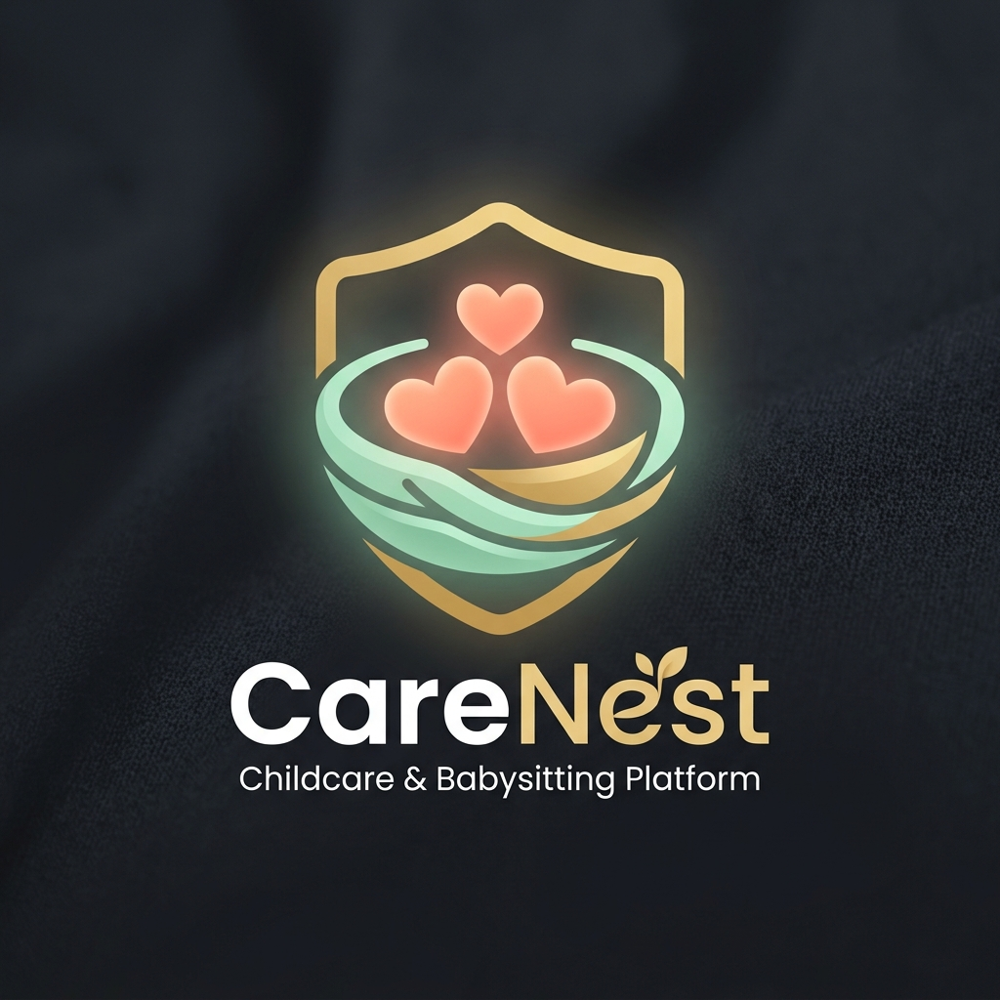
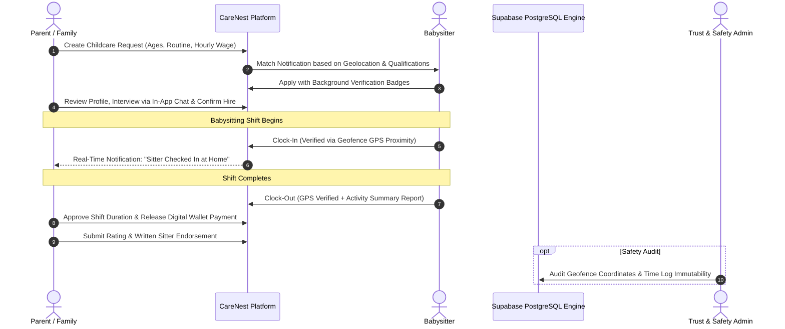

<div align="center">

<p align="center">
  
  
</p>
<p align="center">
  <em>Left: Production Client Mark (Star Sitter) &bull; Right: Architectural Platform Identity (CareNest)</em>
</p>

# CareNest Ecosystem

### Verified Childcare Marketplace, Babysitter Booking & Family Safety Platform

[](https://flutter.dev)
[](https://nextjs.org)
[](https://supabase.com)
[](https://dart.dev)
[](https://typescriptlang.org)
[](https://postgresql.org)
[](LICENSE)

<p align="center">
  <b>CareNest</b> is a full-stack, enterprise-grade childcare and babysitter discovery ecosystem. Built with a monorepo architecture featuring two dedicated Flutter mobile apps (Family & Sitter), an administrative Next.js web portal, and a hardened Supabase/PostgreSQL backend with fine-grained Row-Level Security (RLS).
</p>

</div>

---

## 🌟 Ecosystem Architecture

CareNest bridges families seeking trusted childcare with certified, background-checked babysitters through verified credentials, geofenced shift clocking, and secure digital escrow wallets.

```mermaid
graph TD
    subgraph CareNest Monorepo Ecosystem
        direction TB
        F[Family Mobile App / Flutter]
        S[Sitter Mobile App / Flutter]
        W[Admin Web Portal / Next.js]
        B[(Supabase / PostgreSQL Cloud Engine)]
    end

    subgraph Family Experience
        F --> F1[Post Babysitting Jobs & Special Care Notes]
        F --> F2[Browse Certified Sitters & Badges]
        F --> F3[Direct Real-Time Chat & Video Calls]
        F --> F4[Geofenced Shift Monitoring & Timeline]
        F --> F5[Wallet Milestone Payments & Tipping]
    end

    subgraph Babysitter Experience
        S --> S1[Availability & Hourly Rate Schedule]
        S --> S2[Job Applications & Offer Negotiation]
        S --> S3[Geofence-Enforced Clock-In & Out]
        S --> S4[Guardian Consent Flow for Minor Sitters]
        S --> S5[Earnings Ledger & Instant Withdrawal]
    end

    subgraph Platform Trust & Governance
        W --> W1[Sitter Certification & ID Vetting]
        W --> W2[Parent Background Checks]
        W --> W3[Dispute Arbitration & Audit Logs]
        W --> W4[Platform Revenue & Wage Rules]
    end

    F <-->|Realtime Sync & RLS| B
    S <-->|Realtime Sync & RLS| B
    W <-->|Management RPCs| B
```



---

## ⏱️ Geofenced Booking & Safety Lifecycle



---

## 📁 Repository Structure

```
CareNest-Ecosystem/
├── assets/
│   └── branding/
│       └── logo.png               # Official brand identity
├── apps/
│   ├── mobile/
│   │   ├── family/                # Flutter iOS & Android app for Parents
│   │   │   ├── lib/               # Job posting, sitter discovery, chat, wallet
│   │   │   └── assets/            # Theme vectors, family UI icons
│   │   └── sitter/                # Flutter iOS & Android app for Babysitters
│   │       ├── lib/               # Shift clocking, applications, guardian consent
│   │       └── assets/            # Performer & sitter assets
│   └── web/
│       └── admin/                 # Next.js 14 App Router Administrator Portal
│           ├── src/app/           # Certification vetting, disputes, system wages
│           └── src/components/    # Shared Tailwind and shadcn UI components
├── packages/
│   └── core/                      # Shared Dart business logic & models
│       ├── lib/src/data/          # Supabase repositories (Jobs, Sitters, Wallet, Chat)
│       └── lib/src/validation/    # Age parsing, geofence, and withdrawal validators
├── backend/
│   └── supabase/                  # Supabase Enterprise Configuration
│       ├── migrations/            # 28+ PostgreSQL migrations (Schemas, RLS, RPCs, Triggers)
│       │   ├── 00_schema/         # Core tables (users, families, sitters, wallet)
│       │   ├── 01_rls/            # Hardened Row-Level Security policies
│       │   ├── 02_functions/      # Database stored procedures (RPCs)
│       │   └── 03_triggers/       # Real-time publications & webhooks
│       └── functions/             # Supabase Edge Functions (Deno / TypeScript)
└── README.md
```

---

## ✨ Enterprise Features

### 🛡️ 1. Trust, Safety & Row-Level Security
- **Hardened PostgreSQL RLS:** Families can only access sitters who have applied or are publicly available; private home addresses are strictly shielded until a booking contract is finalized.
- **Guardian Consent Workflows:** Edge functions and database triggers that enforce legal parental consent for teenage babysitters.
- **Geofence Clocking Immutability:** GPS coordinates are mathematically validated on clock-in and clock-out to ensure authentic presence on-site.

### 📱 2. Family Experience (`apps/mobile/family`)
- **Child Profile Cards:** Special care notes, dietary restrictions, emergency contact numbers, and bedtime routines.
- **Instant Booking Radar:** Locate nearby vetted caregivers for immediate date-night or emergency childcare.
- **Integrated Milestone Wallet:** Pre-authorize payments into escrow with automatic hourly calculation.

### 🧸 3. Babysitter Experience (`apps/mobile/sitter`)
- **Certification Showcase:** First Aid, CPR, Infant Care, and Early Childhood Education credential attachments.
- **Shift & Wage Ledger:** Transparent breakdown of gross earnings, platform commission, and instant bank transfers.
- **Direct Family Messaging:** In-app encrypted chat with read receipts and real-time push notifications.

---

## 🚀 Getting Started

### 1. Mobile Apps
```bash
# To run Family App
cd apps/mobile/family
flutter pub get
flutter run

# To run Sitter App
cd apps/mobile/sitter
flutter pub get
flutter run
```

### 2. Admin Web Portal
```bash
cd apps/web/admin
npm install
npm run dev
# Dashboard opens on http://localhost:3000
```

### 3. Backend (Supabase Local Development)
```bash
cd backend/supabase
# Ensure Docker is running
supabase start
supabase db reset  # Applies all migrations & seed data
```

---

## 🔒 Confidentiality & White-Label Notice
This repository is an open-source demonstration and portfolio showcase. All proprietary client data, commercial vendor contracts, live API tokens, and private Apple signing certificates have been sanitized and decoupled.

---

## 👨‍💻 Author
**Muhammad Ali**
- GitHub: [@itismemuhammadali](https://github.com/itismemuhammadali)
- Portfolio & Engineering Showcase
