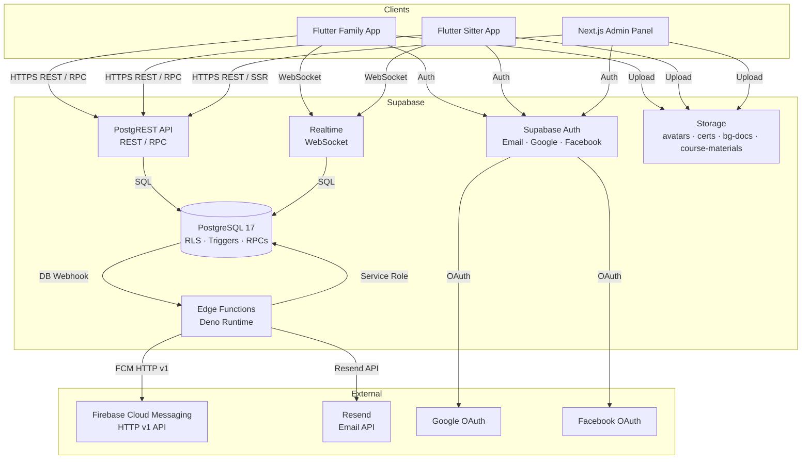
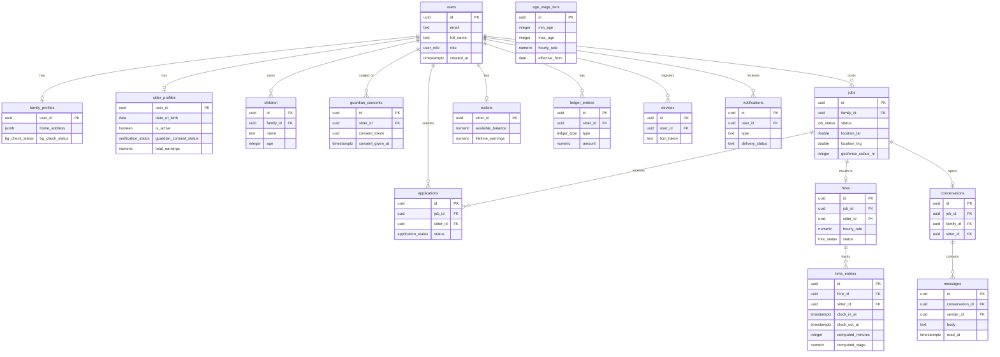
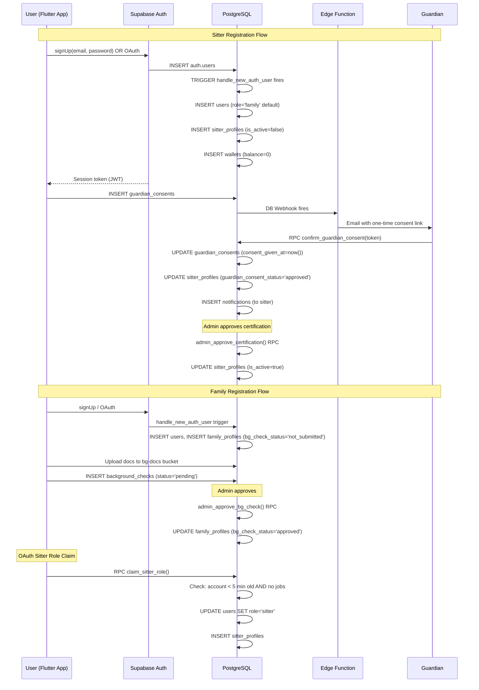
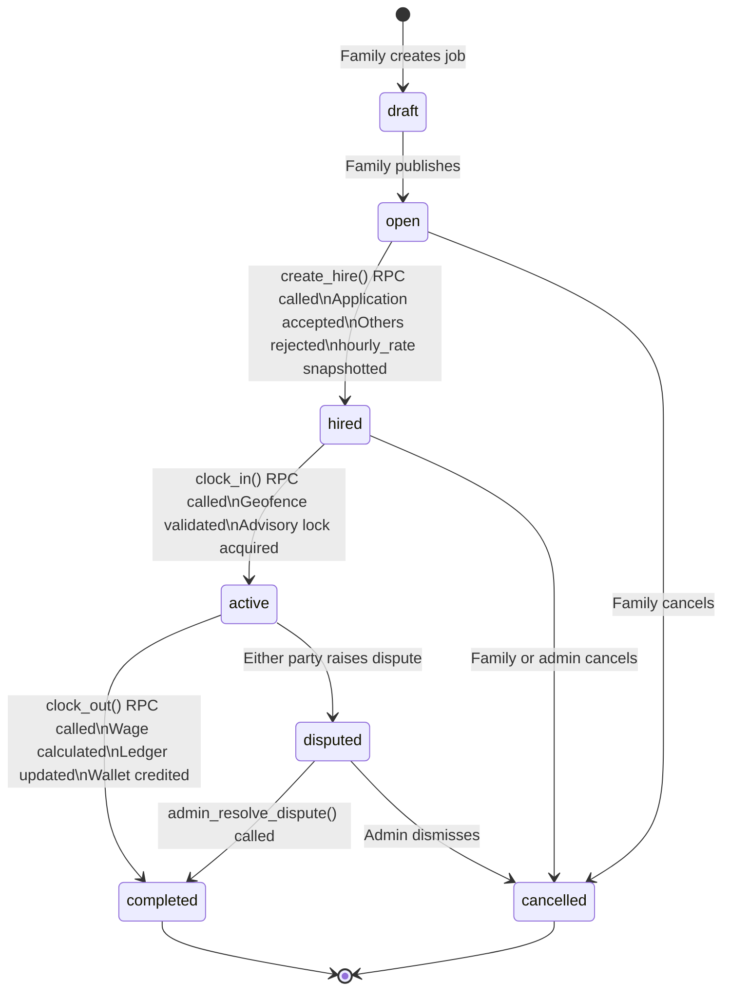
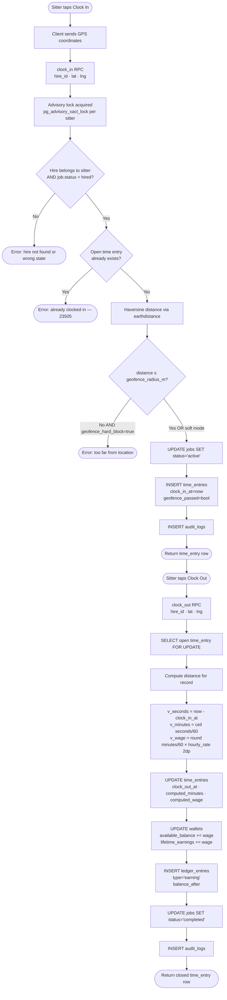
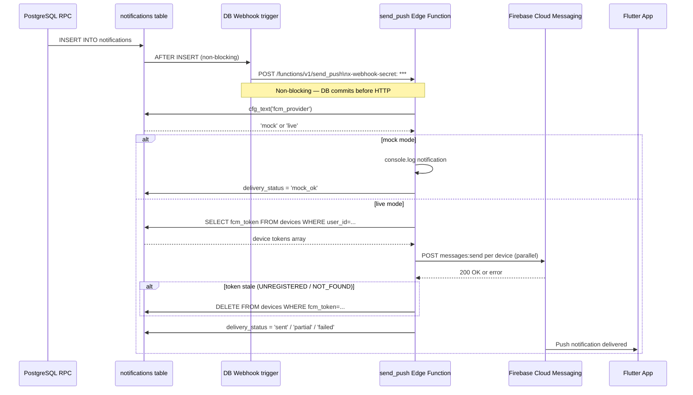

# Star Sitters — Backend

> **PostgreSQL · Supabase · Deno Edge Functions · Firebase Cloud Messaging**
>
> The complete backend for Star Sitters — a safety-first two-sided mobile marketplace connecting **teen babysitters (ages 11–17)** with **families**. Every sitter requires guardian consent plus admin certification approval. Every family requires an admin-reviewed background check before posting jobs.

---

## Table of Contents

1. [Platform Overview](#1-platform-overview)
2. [Repository Map](#2-repository-map)
3. [Related Repositories](#3-related-repositories)
4. [Tech Stack](#4-tech-stack)
5. [System Architecture](#5-system-architecture)
6. [Database Schema](#6-database-schema)
   - [6.1 Enumerations](#61-enumerations)
   - [6.2 Core Tables — Full Schema](#62-core-tables--full-schema)
   - [6.3 Entity-Relationship Diagram](#63-entity-relationship-diagram)
7. [Auth Flow](#7-auth-flow)
   - [7.1 Sequence Diagram](#71-sequence-diagram)
   - [7.2 OAuth Deep Links](#72-oauth-deep-links)
   - [7.3 Idle Timeout](#73-idle-timeout)
8. [Row-Level Security](#8-row-level-security)
   - [8.1 Helper Functions](#81-helper-functions)
   - [8.2 RLS Policy Reference](#82-rls-policy-reference)
   - [8.3 RLS Authorization Decision Tree](#83-rls-authorization-decision-tree)
9. [Job Lifecycle](#9-job-lifecycle)
   - [9.1 State Machine Diagram](#91-state-machine-diagram)
10. [Clock-In / Clock-Out and Wage Calculation](#10-clock-in--clock-out-and-wage-calculation)
    - [10.1 Flow Diagram](#101-flow-diagram)
    - [10.2 Wage Formula](#102-wage-formula)
11. [SECURITY DEFINER RPCs](#11-security-definer-rpcs)
    - [11.1 RPC Reference Table](#111-rpc-reference-table)
    - [11.2 RPC SQL Source](#112-rpc-sql-source)
12. [Edge Functions](#12-edge-functions)
    - [12.1 send\_push](#121-send_push)
    - [12.2 send\_guardian\_consent\_email](#122-send_guardian_consent_email)
    - [12.3 Push Notification Pipeline Diagram](#123-push-notification-pipeline-diagram)
13. [Storage Buckets](#13-storage-buckets)
14. [Realtime](#14-realtime)
15. [Environment Variables](#15-environment-variables)
16. [Migration History](#16-migration-history)
17. [Local Development](#17-local-development)
18. [Deployment](#18-deployment)
19. [Dart / Flutter Usage Examples](#19-dart--flutter-usage-examples)
20. [Admin Panel Integration](#20-admin-panel-integration)
21. [Security Notes](#21-security-notes)
22. [Testing](#22-testing)
23. [Contributing](#23-contributing)

---

## 1. Platform Overview

Star Sitters is a **two-sided marketplace** designed from the ground up with the safety of minors as the primary constraint. The platform enforces a strict onboarding funnel before any real-world work can occur:

| Actor | Pre-requisites before platform access |
|-------|---------------------------------------|
| **Sitter** (age 11–17) | Guardian consent (email magic link) **and** admin-approved certification |
| **Family** | Admin-approved background check |

No amount of client-side manipulation can bypass these gates — every guard lives in `SECURITY DEFINER` PostgreSQL functions that the database engine itself enforces, regardless of what the calling client sends.

### Safety Architecture at a Glance

- **Guardian consent**: sitter registers → platform emails guardian → guardian clicks one-time token → `confirm_guardian_consent()` RPC atomically marks consent → admin reviews certification → admin activates sitter
- **Background check**: family uploads docs → admin reviews → `admin_approve_bg_check()` flips status → family can now post jobs; sitters only see jobs from approved families
- **Geofence**: sitter must be within `geofence_radius_m` (default 150 m) of the job address to clock in; a `geofence_hard_block` system config flag turns this into a hard rejection
- **Immutability triggers**: columns like `role`, `is_active`, `bg_check_status`, `guardian_consent_status` are locked at the trigger level — no RLS policy bypass can flip them without the `app.bypass_immutability` GUC set by a privileged RPC

---

## 2. Repository Map

```
starsitters-backend/
├── supabase/
│   ├── config.toml                  # Local dev Supabase config (auth, OAuth, ports)
│   ├── seed.sql                     # Dev seed data (test accounts, wage tiers, courses)
│   └── migrations/                  # 60 .sql migration files (see §16)
│       ├── 20260209100001_extensions.sql
│       ├── 20260209100002_types_enums.sql
│       ├── ...
│       └── 20260519000001_claim_sitter_role.sql
├── supabase/functions/
│   ├── send_push/
│   │   └── index.ts                 # FCM HTTP v1 push notification dispatcher
│   └── send_guardian_consent_email/
│       └── index.ts                 # Guardian consent email via Resend
├── docs/
│   ├── BACKEND.md                   # Comprehensive internal reference (master doc)
│   ├── DEPLOY.md                    # Deployment order of operations
│   ├── ENV.md                       # Environment variable locations guide
│   ├── LOCAL_DEV.md                 # Local development walkthrough
│   ├── TESTING.md                   # Test strategy and commands
│   ├── SECRETS_AND_ENV.md           # Secret management guide
│   └── HOSTED_CLOUD_SETUP.md        # Hosted Supabase setup steps
└── scripts/                         # Helper shell scripts
```

---

## 3. Related Repositories

| Repository | Stack | Purpose |
|------------|-------|---------|
| [Muhammadali2025222/Star\_Sitter\_Family](https://github.com/Muhammadali2025222/Star_Sitter_Family) | Flutter | Family-side mobile app (iOS + Android) |
| [Muhammadali2025222/Star\_Sitter\_Baby\_Sitter](https://github.com/Muhammadali2025222/Star_Sitter_Baby_Sitter) | Flutter | Sitter-side mobile app (iOS + Android) |
| [naqiiabbas/StarSitters](https://github.com/naqiiabbas/StarSitters) | Next.js 15 + Tailwind v4 | Admin panel (web) |
| [T361/star\_sitters\_core](https://github.com/T361/star_sitters_core) | Dart package | Shared models, RPC clients, constants — path dependency in both Flutter apps |
| **T361/starsitters-backend** | PostgreSQL + Deno | **This repo** — all migrations, RPCs, and Edge Functions |

---

## 4. Tech Stack

| Layer | Technology | Version / Notes |
|-------|-----------|-----------------|
| Database | PostgreSQL | 17 (via Supabase) |
| Backend-as-a-Service | Supabase | Cloud hosted + local CLI |
| Auth | Supabase Auth | Email/password, Google OAuth, Facebook OAuth; PKCE flow |
| Authorization | PostgreSQL RLS | Row-Level Security on every table; `SECURITY DEFINER` helpers |
| Realtime | Supabase Realtime | WebSocket subscriptions for chat, job status, notifications |
| Server Logic | PostgreSQL functions | `SECURITY DEFINER` RPCs called via PostgREST |
| Edge Functions | Deno (TypeScript) | Hosted on Supabase Edge Runtime |
| Push Notifications | Firebase Cloud Messaging | HTTP v1 API with OAuth 2.0 service account JWT |
| Email | Resend | Guardian consent emails; configurable via `system_config` table |
| Admin UI | Next.js 15 + Tailwind CSS v4 | Supabase SSR client |
| Geofencing | PostGIS `earthdistance` | Haversine distance for clock-in validation |
| Shared Flutter code | `star_sitters_core` Dart package | Path dependency; models, Supabase RPC wrappers |

---

## 5. System Architecture



---

## 6. Database Schema

### 6.1 Enumerations

All PostgreSQL `ENUM` types defined in `20260209100002_types_enums.sql`:

| Type Name | Values | Used In |
|-----------|--------|---------|
| `user_role` | `family`, `sitter`, `admin` | `users.role` |
| `bg_check_status` | `not_submitted`, `pending`, `approved`, `rejected` | `family_profiles.bg_check_status` |
| `job_status` | `draft`, `open`, `hired`, `active`, `completed`, `cancelled` | `jobs.status` |
| `application_status` | `pending`, `accepted`, `rejected`, `withdrawn` | `applications.status` |
| `hire_status` | `active`, `completed`, `disputed`, `cancelled` | `hires.status` |
| `verification_status` | `pending`, `approved`, `rejected` | `certifications.status`, `guardian_consents.status` |
| `ledger_type` | `earning`, `adjustment`, `withdrawal` | `ledger_entries.type` |
| `platform_type` | `ios`, `android` | `devices.platform` |
| `withdrawal_status` | `pending`, `paid`, `cancelled` | `withdrawal_requests.status` |

---

### 6.2 Core Tables — Full Schema

<details>
<summary><strong>users</strong> — Core identity record for all authenticated users</summary>

| Column | Type | Constraints | Description |
|--------|------|-------------|-------------|
| `id` | `uuid` | PK, FK → `auth.users.id` ON DELETE CASCADE | Matches Supabase Auth UID exactly |
| `email` | `text` | NOT NULL, UNIQUE | Synced from `auth.users`; use `auth.updateUser()` to change |
| `full_name` | `text` | | Display name |
| `phone` | `text` | | Optional phone number |
| `avatar_url` | `text` | | Path/URL to avatar in `avatars` storage bucket |
| `role` | `user_role` | NOT NULL, DEFAULT `'family'` | Locked by `trg_users_role_immutable` trigger |
| `created_at` | `timestamptz` | NOT NULL, DEFAULT `now()` | Account creation timestamp |
| `updated_at` | `timestamptz` | DEFAULT `now()` | Auto-updated by trigger |

**Trigger**: `handle_new_auth_user` fires on `auth.users INSERT` → creates `users` row, `family_profiles` row, and `wallets` row automatically.

Safe client writes: `full_name`, `phone`, `avatar_url`. Role is locked; email is managed by Auth.

</details>

<details>
<summary><strong>family_profiles</strong> — Extended profile data for family accounts</summary>

| Column | Type | Constraints | Description |
|--------|------|-------------|-------------|
| `user_id` | `uuid` | PK, FK → `users.id` ON DELETE CASCADE | One-to-one with `users` |
| `home_address` | `jsonb` | | `{street, city, state, zip, country}` |
| `home_lat` | `double precision` | | Latitude |
| `home_lng` | `double precision` | | Longitude |
| `home_safety_info` | `text` | | Free-text notes (pets, alarms, etc.) |
| `emergency_contact` | `jsonb` | | `{name, phone, relationship}` |
| `babysitter_prefs` | `jsonb` | | Preferences: age range, required certs |
| `bg_check_status` | `bg_check_status` | NOT NULL, DEFAULT `'not_submitted'` | Admin-locked; denormalized for fast RLS |
| `rejection_reason` | `text` | | Set by admin when bg check is rejected |
| `created_at` | `timestamptz` | DEFAULT `now()` | |
| `updated_at` | `timestamptz` | DEFAULT `now()` | |

**Admin-locked columns**: `bg_check_status`, `rejection_reason` — locked by `trg_family_lock_admin_fields`; only flippable inside `admin_approve_bg_check()` RPC with `app.bypass_immutability = true`.

</details>

<details>
<summary><strong>sitter_profiles</strong> — Extended profile data for sitter accounts</summary>

| Column | Type | Constraints | Description |
|--------|------|-------------|-------------|
| `user_id` | `uuid` | PK, FK → `users.id` ON DELETE CASCADE | One-to-one with `users` |
| `date_of_birth` | `date` | NOT NULL | Used for age-tiered wage calculation |
| `bio` | `text` | | Sitter self-description |
| `is_active` | `boolean` | NOT NULL, DEFAULT `false` | Admin-controlled; required to apply to jobs |
| `guardian_consent_status` | `verification_status` | NOT NULL, DEFAULT `'pending'` | Set to `'approved'` by `confirm_guardian_consent()` |
| `suspension_reason` | `text` | | Populated by `admin_suspend_sitter()` RPC |
| `total_minutes_worked` | `integer` | NOT NULL, DEFAULT `0` | Maintained by `fn_update_sitter_totals` trigger |
| `total_earnings` | `numeric(12,2)` | NOT NULL, DEFAULT `0.00` | Lifetime gross earnings |
| `created_at` | `timestamptz` | DEFAULT `now()` | |
| `updated_at` | `timestamptz` | DEFAULT `now()` | |

**Admin-locked**: `is_active`, `guardian_consent_status`, `total_minutes_worked`, `total_earnings` — locked by `trg_sitter_lock_admin_fields`.

</details>

<details>
<summary><strong>children</strong> — Child profiles linked to a family</summary>

| Column | Type | Constraints | Description |
|--------|------|-------------|-------------|
| `id` | `uuid` | PK, DEFAULT `gen_random_uuid()` | |
| `family_id` | `uuid` | NOT NULL, FK → `users.id` | Owning family |
| `name` | `text` | NOT NULL | Child's first name |
| `age` | `integer` | NOT NULL, CHECK `age > 0` | Age in years |
| `notes` | `text` | | Special needs, allergies, instructions |
| `created_at` | `timestamptz` | DEFAULT `now()` | |

</details>

<details>
<summary><strong>guardian_consents</strong> — Parental consent records for sitter onboarding</summary>

| Column | Type | Constraints | Description |
|--------|------|-------------|-------------|
| `id` | `uuid` | PK, DEFAULT `gen_random_uuid()` | |
| `sitter_id` | `uuid` | NOT NULL, FK → `users.id` | The sitter needing consent |
| `guardian_name` | `text` | NOT NULL | Guardian's full name |
| `guardian_email` | `text` | NOT NULL | Email where consent link is sent |
| `guardian_phone` | `text` | | Optional phone |
| `consent_token` | `uuid` | NOT NULL, UNIQUE, DEFAULT `gen_random_uuid()` | One-time token embedded in email link |
| `consent_given_at` | `timestamptz` | | Set when guardian clicks link; NULL = not yet consented |
| `consent_ip` | `inet` | | IP address recorded at consent time |
| `created_at` | `timestamptz` | DEFAULT `now()` | Used for 24h token expiry check |

**Rate limit**: migration `20260517001300` prevents more than 3 consent requests per sitter per 24 hours.

</details>

<details>
<summary><strong>jobs</strong> — Job postings created by families</summary>

| Column | Type | Constraints | Description |
|--------|------|-------------|-------------|
| `id` | `uuid` | PK, DEFAULT `gen_random_uuid()` | |
| `family_id` | `uuid` | NOT NULL, FK → `users.id` | Posting family; must have `bg_check_status = 'approved'` |
| `title` | `text` | NOT NULL | Short job title |
| `description` | `text` | | Full job description |
| `date` | `date` | NOT NULL | Date of the babysitting job |
| `start_time` | `time` | NOT NULL | Expected start time |
| `end_time` | `time` | | Expected end time |
| `number_of_children` | `integer` | NOT NULL, DEFAULT `1` | |
| `child_ids` | `uuid[]` | | References to `children.id` rows |
| `location_lat` | `double precision` | NOT NULL | Job location latitude |
| `location_lng` | `double precision` | NOT NULL | Job location longitude |
| `location_address` | `jsonb` | | `{street, city, state, zip}` |
| `geofence_radius_m` | `integer` | NOT NULL, DEFAULT `150` | Sitter must be within this distance to clock in |
| `required_certifications` | `text[]` | | e.g. `['first_aid', 'cpr']` |
| `status` | `job_status` | NOT NULL, DEFAULT `'draft'` | State machine (see §9) |
| `created_at` | `timestamptz` | DEFAULT `now()` | |
| `updated_at` | `timestamptz` | DEFAULT `now()` | |

**RLS insert guard**: `WITH CHECK` requires `bg_check_status = 'approved'` — unapproved families cannot post jobs even via forged requests.

</details>

<details>
<summary><strong>applications</strong> — Sitter applications to job postings</summary>

| Column | Type | Constraints | Description |
|--------|------|-------------|-------------|
| `id` | `uuid` | PK, DEFAULT `gen_random_uuid()` | |
| `job_id` | `uuid` | NOT NULL, FK → `jobs.id` | |
| `sitter_id` | `uuid` | NOT NULL, FK → `users.id` | |
| `cover_message` | `text` | | Optional cover letter |
| `status` | `application_status` | NOT NULL, DEFAULT `'pending'` | |
| `applied_at` | `timestamptz` | DEFAULT `now()` | |
| `updated_at` | `timestamptz` | DEFAULT `now()` | |

**Constraint**: `UNIQUE(job_id, sitter_id)` — one application per sitter per job.

**Note**: Direct INSERT is denied by RLS. Must use `create_application()` SECURITY DEFINER RPC which validates `is_active = true`.

</details>

<details>
<summary><strong>hires</strong> — Active hire records linking family, job, and sitter</summary>

| Column | Type | Constraints | Description |
|--------|------|-------------|-------------|
| `id` | `uuid` | PK, DEFAULT `gen_random_uuid()` | |
| `job_id` | `uuid` | NOT NULL, FK → `jobs.id` | |
| `sitter_id` | `uuid` | NOT NULL, FK → `users.id` | |
| `family_id` | `uuid` | NOT NULL, FK → `users.id` | Denormalized for fast RLS joins |
| `hourly_rate` | `numeric(10,2)` | NOT NULL | **Snapshotted** at hire time; immutable |
| `hired_at` | `timestamptz` | DEFAULT `now()` | |
| `status` | `hire_status` | NOT NULL, DEFAULT `'active'` | |

**Note**: Created exclusively by `create_hire()` RPC, which atomically accepts one application, rejects others, and opens a conversation thread.

</details>

<details>
<summary><strong>time_entries</strong> — Clock-in/out records for active jobs</summary>

| Column | Type | Constraints | Description |
|--------|------|-------------|-------------|
| `id` | `uuid` | PK | |
| `hire_id` | `uuid` | NOT NULL, FK → `hires.id` | |
| `sitter_id` | `uuid` | NOT NULL, FK → `users.id` | Denormalized for fast RLS |
| `clock_in_at` | `timestamptz` | NOT NULL, DEFAULT `now()` | |
| `clock_out_at` | `timestamptz` | | NULL while job is in progress |
| `clock_in_lat` | `double precision` | NOT NULL | GPS latitude at clock-in |
| `clock_in_lng` | `double precision` | NOT NULL | GPS longitude at clock-in |
| `clock_out_lat` | `double precision` | | GPS latitude at clock-out |
| `clock_out_lng` | `double precision` | | GPS longitude at clock-out |
| `geofence_passed` | `boolean` | | Whether sitter was within geofence |
| `computed_minutes` | `integer` | | `ceil(seconds / 60)` — set on clock-out |
| `computed_wage` | `numeric(12,2)` | | Final wage for this session |

**Constraint**: Partial unique index `uq_one_open_time_entry` on `(sitter_id) WHERE clock_out_at IS NULL` — prevents two simultaneous open entries per sitter.

**Constraint**: `CHECK (clock_out_at > clock_in_at OR clock_out_at IS NULL)`.

</details>

<details>
<summary><strong>age_wage_tiers</strong> — Age-tiered hourly wage configuration</summary>

| Column | Type | Constraints | Description |
|--------|------|-------------|-------------|
| `id` | `uuid` | PK | |
| `min_age` | `integer` | NOT NULL | Minimum sitter age (inclusive) |
| `max_age` | `integer` | NOT NULL | Maximum sitter age (inclusive) |
| `hourly_rate` | `numeric(10,2)` | NOT NULL | Hourly rate in USD |
| `effective_from` | `date` | NOT NULL | Rate effective from this date; latest matching row wins |

**Example tiers** (from seed data):

| Age Range | Rate |
|-----------|------|
| 11–12 | $8.00/hr |
| 13–14 | $9.50/hr |
| 15–17 | $11.00/hr |

</details>

<details>
<summary><strong>wallets</strong> — Sitter earnings wallet</summary>

| Column | Type | Constraints | Description |
|--------|------|-------------|-------------|
| `sitter_id` | `uuid` | PK, FK → `users.id` | One wallet per sitter |
| `available_balance` | `numeric(12,2)` | NOT NULL, DEFAULT `0.00` | Balance available for withdrawal |
| `pending_balance` | `numeric(12,2)` | NOT NULL, DEFAULT `0.00` | Reserved for in-flight withdrawal requests |
| `lifetime_earnings` | `numeric(12,2)` | NOT NULL, DEFAULT `0.00` | Running total (never decremented) |
| `updated_at` | `timestamptz` | DEFAULT `now()` | |

No client writes — updated only by `clock_out()` and `admin_pay_withdrawal()` RPCs.

</details>

<details>
<summary><strong>ledger_entries</strong> — Immutable financial audit trail</summary>

| Column | Type | Constraints | Description |
|--------|------|-------------|-------------|
| `id` | `uuid` | PK | |
| `sitter_id` | `uuid` | NOT NULL, FK → `users.id` | |
| `type` | `ledger_type` | NOT NULL | `earning`, `adjustment`, `withdrawal` |
| `amount` | `numeric(12,2)` | NOT NULL | Positive for credits, negative for debits |
| `reference_type` | `text` | | `'time_entry'` or `'withdrawal_request'` |
| `reference_id` | `uuid` | | FK to the source record |
| `balance_after` | `numeric(12,2)` | | Wallet `available_balance` after this entry |
| `description` | `text` | | Human-readable note |
| `created_at` | `timestamptz` | DEFAULT `now()` | |

No UPDATE or DELETE policies — append-only.

</details>

<details>
<summary><strong>conversations and messages</strong> — In-app chat</summary>

**`conversations`**

| Column | Type | Description |
|--------|------|-------------|
| `id` | `uuid` PK | |
| `job_id` | `uuid` NOT NULL FK | The job this conversation is about |
| `family_id` | `uuid` NOT NULL FK | |
| `sitter_id` | `uuid` NOT NULL FK | |
| `created_at` | `timestamptz` | |

Constraint: `UNIQUE(job_id, sitter_id)`.

**`messages`**

| Column | Type | Description |
|--------|------|-------------|
| `id` | `uuid` PK | |
| `conversation_id` | `uuid` NOT NULL FK | |
| `sender_id` | `uuid` NOT NULL FK | Must be a participant (enforced by RLS `WITH CHECK`) |
| `body` | `text` NOT NULL | |
| `sent_at` | `timestamptz` DEFAULT `now()` | |
| `read_at` | `timestamptz` | NULL = unread |

Messages are never updated or deleted. Both tables are in the Supabase Realtime publication.

</details>

<details>
<summary><strong>devices</strong> — FCM push notification tokens</summary>

| Column | Type | Description |
|--------|------|-------------|
| `id` | `uuid` PK | |
| `user_id` | `uuid` NOT NULL FK | Owning user |
| `fcm_token` | `text` NOT NULL UNIQUE | Firebase registration token |
| `platform` | `platform_type` NOT NULL | `ios` or `android` |
| `updated_at` | `timestamptz` DEFAULT `now()` | Refreshed on token rotation |

Stale tokens are deleted by `send_push` Edge Function when FCM returns `UNREGISTERED` or `NOT_FOUND`.

</details>

<details>
<summary><strong>notifications</strong> — In-app notification inbox</summary>

| Column | Type | Description |
|--------|------|-------------|
| `id` | `uuid` PK | |
| `user_id` | `uuid` NOT NULL FK | |
| `type` | `text` NOT NULL | e.g. `bg_check_result`, `cert_result`, `hire_created`, `withdrawal_paid` |
| `title` | `text` | Push notification title |
| `body` | `text` | Push notification body |
| `data` | `jsonb` | Arbitrary payload forwarded to FCM `data` field |
| `delivery_status` | `text` | `mock_ok`, `sent`, `partial`, `failed`, `no_devices` |
| `read_at` | `timestamptz` | NULL = unread |
| `created_at` | `timestamptz` DEFAULT `now()` | |

**Pipeline**: INSERT → DB Webhook → `send_push` Edge Function → FCM HTTP v1.

</details>

<details>
<summary><strong>audit_logs</strong> — Append-only security audit trail</summary>

| Column | Type | Description |
|--------|------|-------------|
| `id` | `bigint` PK GENERATED ALWAYS | Auto-increment |
| `actor_id` | `uuid` | User performing the action (NULL for anonymous) |
| `action` | `text` NOT NULL | e.g. `clock_in`, `hire_created`, `bg_check_approved` |
| `entity_type` | `text` | Table name of the affected record |
| `entity_id` | `uuid` | Primary key of the affected record |
| `before_state` | `jsonb` | Row before change |
| `after_state` | `jsonb` | Row after change |
| `created_at` | `timestamptz` DEFAULT `now()` | |

No UPDATE or DELETE policies. Written by every SECURITY DEFINER RPC.

</details>

<details>
<summary><strong>Other tables</strong></summary>

| Table | Purpose |
|-------|---------|
| `background_checks` | Family background check submissions; status updated by `admin_approve_bg_check()` |
| `certifications` | Sitter certification uploads; status updated by `admin_approve_certification()` |
| `courses` | Course catalog for sitters; includes `questions` (jsonb), `passing_score`, `material_paths` |
| `certification_submissions` | Sitter course quiz attempts with `score` and `passed` columns |
| `disputes` | Job disputes raised by either party; resolved by admin via `admin_resolve_dispute()` |
| `reports` | User reports (harassment, misconduct); reviewed by admin |
| `system_config` | Key-value runtime config; read via `cfg_text()` / `cfg_bool()` RPCs |
| `uploaded_documents` | General document uploads with `document_type`, `storage_path`, `status` |
| `sitter_emergency_contacts` | Sitter emergency contact info (migration `20260516100000`) |
| `sitter_addresses` | Sitter home addresses (migration `20260516200000`) |
| `withdrawal_requests` | Sitter withdrawal requests; approved by `admin_pay_withdrawal()` |
| `admin_users` | `(id UUID PK FK users.id)` — source of truth for admin identity |

</details>

---

### 6.3 Entity-Relationship Diagram



---

## 7. Auth Flow

### 7.1 Sequence Diagram



### 7.2 OAuth Deep Links

| App | Deep Link Scheme |
|-----|-----------------|
| Flutter Family App | `io.supabase.starsitterfamily://login-callback` |
| Flutter Sitter App | `io.supabase.starsittersitter://login-callback` |
| Next.js Admin (local) | `http://localhost:3000` |
| Password reset | `http://localhost:3000/reset-password` |

Mirror all of these in the hosted Supabase Dashboard under **Authentication → URL Configuration → Redirect URLs**.

### 7.3 Idle Timeout

Both Flutter apps implement a **15-minute inactivity auto-signout** enforced client-side via an activity timer. JWT expiry is set to **3600 seconds (1 hour)** in `config.toml`; Supabase Auth handles silent token refresh automatically.

---

## 8. Row-Level Security

Every table in the `public` schema has RLS enabled. No table is left unprotected.

### 8.1 Helper Functions

```sql
-- Returns the role of the currently authenticated user.
-- SECURITY DEFINER prevents privilege escalation via search_path.
CREATE OR REPLACE FUNCTION public.current_user_role()
RETURNS public.user_role
LANGUAGE sql STABLE SECURITY DEFINER
SET search_path = public AS $$
  SELECT role FROM public.users WHERE id = auth.uid();
$$;

-- Returns true if the current user exists in admin_users.
-- SECURITY DEFINER breaks the RLS recursion cycle.
CREATE OR REPLACE FUNCTION public.is_admin()
RETURNS boolean
LANGUAGE sql STABLE SECURITY DEFINER
SET search_path = public AS $$
  SELECT EXISTS (
    SELECT 1 FROM public.admin_users WHERE id = auth.uid()
  );
$$;
```

`admin_only()` (migration `20260209100012_helpers.sql`) raises `42501 (insufficient_privilege)` immediately if called by a non-admin — used as the first line of every admin RPC.

### 8.2 RLS Policy Reference

| Table | Policy Name | Operation | Allowed When |
|-------|-------------|-----------|--------------|
| `users` | users: select own | SELECT | `id = auth.uid()` |
| `users` | users: admin select all | SELECT | `is_admin()` |
| `users` | users: update own | UPDATE | `id = auth.uid()` |
| `family_profiles` | family_profiles: select own | SELECT | `user_id = auth.uid()` |
| `family_profiles` | family_profiles: sitter sees relevant families | SELECT | sitter role + has application to family's job |
| `family_profiles` | family_profiles: admin select all | SELECT | `is_admin()` |
| `family_profiles` | family_profiles: insert own | INSERT | `user_id = auth.uid()` |
| `family_profiles` | family_profiles: update own | UPDATE | `user_id = auth.uid()` |
| `sitter_profiles` | sitter_profiles: select own | SELECT | `user_id = auth.uid()` |
| `sitter_profiles` | sitter_profiles: family sees active sitters | SELECT | family role + `is_active = true` |
| `sitter_profiles` | sitter_profiles: admin select all | SELECT | `is_admin()` |
| `sitter_profiles` | sitter_profiles: update own | UPDATE | `user_id = auth.uid()` |
| `sitter_profiles` | sitter_profiles: admin update | UPDATE | `is_admin()` |
| `children` | children: family select own | SELECT | `family_id = auth.uid()` |
| `children` | children: admin select all | SELECT | `is_admin()` |
| `children` | children: family insert/update/delete | ALL | `family_id = auth.uid()` |
| `guardian_consents` | guardian_consents: sitter select own | SELECT | `sitter_id = auth.uid()` |
| `guardian_consents` | guardian_consents: admin select all | SELECT | `is_admin()` |
| `guardian_consents` | guardian_consents: sitter insert own | INSERT | `sitter_id = auth.uid()` |
| `certifications` | certifications: sitter select own | SELECT | `sitter_id = auth.uid()` |
| `certifications` | certifications: family sees approved certs | SELECT | family role + sitter applied to family's job + status = approved |
| `certifications` | certifications: admin select all | SELECT | `is_admin()` |
| `certifications` | certifications: admin update | UPDATE | `is_admin()` |
| `jobs` | jobs: family select own | SELECT | `family_id = auth.uid()` |
| `jobs` | jobs: sitter sees open jobs | SELECT | sitter role + status = 'open' + family bg_check approved |
| `jobs` | jobs: admin select all | SELECT | `is_admin()` |
| `jobs` | jobs: family insert | INSERT | `family_id = auth.uid()` + `bg_check_status = 'approved'` |
| `jobs` | jobs: family update own | UPDATE | `family_id = auth.uid()` |
| `applications` | applications: sitter select own | SELECT | `sitter_id = auth.uid()` |
| `applications` | applications: family sees own job apps | SELECT | family owns the job |
| `applications` | applications: admin select all | SELECT | `is_admin()` |
| `hires` | hires: family sees own job hires | SELECT | family owns the job |
| `hires` | hires: sitter sees own hires | SELECT | `sitter_id = auth.uid()` |
| `hires` | hires: admin select all | SELECT | `is_admin()` |
| `time_entries` | time_entries: sitter select own | SELECT | `sitter_id = auth.uid()` |
| `time_entries` | time_entries: family sees hire entries | SELECT | family owns the hire's job |
| `time_entries` | time_entries: admin select all | SELECT | `is_admin()` |
| `wallets` | wallets: sitter select own | SELECT | `sitter_id = auth.uid()` |
| `wallets` | wallets: admin select all | SELECT | `is_admin()` |
| `ledger_entries` | ledger_entries: sitter select own | SELECT | `sitter_id = auth.uid()` |
| `ledger_entries` | ledger_entries: admin select all | SELECT | `is_admin()` |
| `conversations` | conversations: participants select | SELECT | `family_id = auth.uid()` OR `sitter_id = auth.uid()` |
| `conversations` | conversations: admin select all | SELECT | `is_admin()` |
| `messages` | messages: participants select | SELECT | caller is conversation participant |
| `messages` | messages: participants insert | INSERT | `sender_id = auth.uid()` + caller is participant |
| `devices` | devices: user select/insert/update/delete own | ALL | `user_id = auth.uid()` |
| `notifications` | notifications: user select own | SELECT | `user_id = auth.uid()` |
| `notifications` | notifications: user update own read_at | UPDATE | `user_id = auth.uid()` |
| `audit_logs` | audit_logs: admin select all | SELECT | `is_admin()` |
| `admin_users` | admin_users: admin select all | SELECT | `is_admin()` |
| `age_wage_tiers` | age_wage_tiers: authenticated read | SELECT | `auth.uid() IS NOT NULL` |
| `age_wage_tiers` | age_wage_tiers: admin write | ALL | `is_admin()` |
| `system_config` | system_config: authenticated read | SELECT | `auth.uid() IS NOT NULL` |
| `system_config` | system_config: admin write | ALL | `is_admin()` |
| `withdrawal_requests` | withdrawal_requests: sitter select own | SELECT | `sitter_id = auth.uid()` |
| `withdrawal_requests` | withdrawal_requests: admin select all | SELECT | `is_admin()` |

### 8.3 RLS Authorization Decision Tree

```mermaid
flowchart TD
    A[Incoming query to public schema] --> B{auth.uid() is null?}
    B -- Yes --> C[DENY — anonymous access blocked]
    B -- No --> D{is_admin = true?}
    D -- Yes --> E[PERMIT — full access to all rows]
    D -- No --> F{What role does JWT carry?}

    F -- family --> G[Family branch]
    F -- sitter --> H[Sitter branch]

    G --> G1{Accessing own data?\nuser_id / family_id = auth.uid}
    G1 -- Yes --> G2[PERMIT own-row access]
    G1 -- No --> G3{Reading sitter profile or cert\nfor a job they posted?}
    G3 -- Yes, conditions met --> G4[PERMIT limited read]
    G3 -- No --> G5[DENY]

    G --> G6{Posting a job INSERT?}
    G6 --> G7{bg_check_status = 'approved'?}
    G7 -- Yes --> G8[PERMIT insert]
    G7 -- No --> G9[DENY — unverified family]

    H --> H1{Accessing own sitter data?}
    H1 -- Yes --> H2[PERMIT]
    H1 -- No --> H3{Reading jobs table?}
    H3 -- status=open AND family approved --> H4[PERMIT]
    H3 -- other rows --> H5[DENY]

    H --> H6{Calling create_application RPC?}
    H6 --> H7{is_active = true?}
    H7 -- Yes --> H8[PERMIT via SECURITY DEFINER RPC]
    H7 -- No --> H9[DENY — unverified sitter]
```

---

## 9. Job Lifecycle

### 9.1 State Machine Diagram



---

## 10. Clock-In / Clock-Out and Wage Calculation

### 10.1 Flow Diagram



### 10.2 Wage Formula

The wage calculation uses the **snapshotted `hourly_rate`** from `hires` — not the current `age_wage_tiers` value. Rate changes after hire creation cannot affect that hire's pay.

```
minutes = ceil(total_seconds / 60)
wage    = round((minutes / 60.0) * hourly_rate, 2)
```

**Example**: Sitter aged 14 (rate $9.50/hr), works 1 h 23 m 42 s:
- `total_seconds = 5022`
- `minutes = ceil(83.7) = 84`
- `wage = round((84 / 60.0) × 9.50, 2) = $13.30`

Age-tier lookup:

```sql
SELECT hourly_rate
FROM public.age_wage_tiers
WHERE v_sitter_age BETWEEN min_age AND max_age
  AND effective_from <= current_date
ORDER BY effective_from DESC
LIMIT 1;
```

If no matching tier exists the RPC raises an exception and clock-out is rejected.

---

## 11. SECURITY DEFINER RPCs

All business-critical mutations go through `SECURITY DEFINER` PostgreSQL functions. This means:

1. The function runs with **permissions of the function owner** (postgres superuser), not the calling client.
2. All auth context comes from `auth.uid()` — set by Supabase from the verified JWT, not from the request body.
3. Clients cannot spoof parameters to bypass validation.

### 11.1 RPC Reference Table

| Function | Caller | Parameters | Returns | Description |
|----------|--------|------------|---------|-------------|
| `create_application(job_id, cover_message?)` | Sitter | `p_job_id uuid`, `p_cover_message text` | `applications` row | Validates `is_active`, job `status='open'`, inserts application |
| `withdraw_application(application_id)` | Sitter | `p_application_id uuid` | `void` | Sets status to `withdrawn` if pending |
| `create_hire(application_id)` | Family | `p_application_id uuid` | `hires` row | Accepts one application, rejects others, snapshots wage rate, opens conversation |
| `clock_in(hire_id, lat, lng)` | Sitter | `p_hire_id uuid`, `p_lat float8`, `p_lng float8` | `time_entries` row | Advisory lock, geofence check, inserts time entry, flips job to `active` |
| `clock_out(hire_id, lat, lng)` | Sitter | `p_hire_id uuid`, `p_lat float8`, `p_lng float8` | `time_entries` row | Calculates wage, credits wallet, inserts ledger, completes job |
| `request_withdrawal(amount, method, account_info?)` | Sitter | `p_amount numeric`, `p_method text`, `p_account_info jsonb` | `withdrawal_requests` row | Validates balance, reserves in `pending_balance`, inserts ledger debit |
| `confirm_guardian_consent(token)` | Anonymous | `p_token uuid` | `boolean` | Atomically claims one-time token, updates consent status, notifies sitter |
| `claim_sitter_role()` | Sitter App OAuth user | — | `void` | Converts fresh OAuth account (< 5 min, no jobs) from `family` to `sitter` |
| `admin_approve_bg_check(family_id, decision, notes?)` | Admin | `p_family_id uuid`, `p_decision text`, `p_notes text` | `void` | Approves or rejects family background check, sends notification |
| `admin_approve_certification(cert_id, decision, notes?)` | Admin | `p_cert_id uuid`, `p_decision text`, `p_notes text` | `void` | Approves/rejects cert; activates sitter if guardian consent also approved |
| `admin_pay_withdrawal(request_id)` | Admin | `p_request_id uuid` | `void` | Marks withdrawal paid, decrements `pending_balance`, notifies sitter |
| `admin_resolve_dispute(dispute_id, resolution)` | Admin | `p_dispute_id uuid`, `p_resolution text` | `void` | Closes dispute, records resolution |
| `admin_dashboard_stats()` | Admin | — | `jsonb` | Aggregate counts: pending bg checks, active jobs, open disputes, withdrawals |
| `admin_list_jobs(status_filter, search, page, page_size)` | Admin | filter params | `jsonb` | Paginated, searchable job list with location data |
| `admin_activate_sitter(user_id)` | Admin | `p_user_id uuid` | `void` | Manually activates sitter |
| `admin_suspend_sitter(user_id, reason)` | Admin | `p_user_id uuid`, `p_reason text` | `void` | Suspends sitter, sets `is_active=false`, stores reason |
| `cfg_text(key, default?)` | Internal | `p_key text`, `p_default text` | `text` | Reads `system_config` table safely |
| `cfg_bool(key, default?)` | Internal | `p_key text`, `p_default boolean` | `boolean` | Reads boolean config value |
| `mark_all_notifications_read()` | Users | — | `void` | Marks all user notifications as read |

### 11.2 RPC SQL Source

<details>
<summary><strong>clock_in — Full SQL</strong></summary>

```sql
CREATE OR REPLACE FUNCTION public.clock_in(
  p_hire_id uuid,
  p_lat     double precision,
  p_lng     double precision
)
RETURNS public.time_entries
LANGUAGE plpgsql SECURITY DEFINER
SET search_path = public AS $$
DECLARE
  v_sitter_id   uuid := auth.uid();
  v_hire        public.hires;
  v_job         public.jobs;
  v_entry       public.time_entries;
  v_geofence_ok boolean;
  v_dist_m      double precision;
  v_hard_block  boolean;
BEGIN
  -- Serialize concurrent clock_in calls per sitter
  PERFORM pg_advisory_xact_lock(hashtext('clock_in:' || v_sitter_id::text));

  SELECT h.* INTO v_hire
    FROM public.hires h
    JOIN public.jobs j ON j.id = h.job_id
   WHERE h.id = p_hire_id
     AND h.sitter_id = v_sitter_id
     AND j.status = 'hired'
  FOR UPDATE;

  IF NOT FOUND THEN
    RAISE EXCEPTION 'hire not found or job not in hired state';
  END IF;

  IF EXISTS (
    SELECT 1 FROM public.time_entries
    WHERE sitter_id = v_sitter_id AND clock_out_at IS NULL
  ) THEN
    RAISE EXCEPTION 'sitter already has an open time entry'
      USING errcode = '23505';
  END IF;

  SELECT * INTO v_job FROM public.jobs WHERE id = v_hire.job_id;

  v_dist_m := earth_distance(
    ll_to_earth(v_job.location_lat, v_job.location_lng),
    ll_to_earth(p_lat, p_lng)
  );
  v_geofence_ok := v_dist_m <= v_job.geofence_radius_m;
  v_hard_block  := public.cfg_bool('geofence_hard_block', false);

  IF NOT v_geofence_ok AND v_hard_block THEN
    RAISE EXCEPTION 'you are %.0f meters from the job location. must be within %sm.',
      v_dist_m, v_job.geofence_radius_m;
  END IF;

  UPDATE public.jobs SET status = 'active' WHERE id = v_job.id;

  INSERT INTO public.time_entries (
    hire_id, sitter_id, clock_in_at,
    clock_in_lat, clock_in_lng, geofence_passed
  ) VALUES (
    p_hire_id, v_sitter_id, now(),
    p_lat, p_lng, v_geofence_ok
  ) RETURNING * INTO v_entry;

  INSERT INTO public.audit_logs (actor_id, action, entity_type, entity_id, after_state)
  VALUES (
    v_sitter_id, 'clock_in', 'time_entries', v_entry.id,
    jsonb_build_object('geofence_passed', v_geofence_ok,
                       'distance_m', round(v_dist_m::numeric, 2),
                       'lat', p_lat, 'lng', p_lng)
  );

  RETURN v_entry;
END;
$$;
```

</details>

<details>
<summary><strong>clock_out — Full SQL</strong></summary>

```sql
CREATE OR REPLACE FUNCTION public.clock_out(
  p_hire_id uuid,
  p_lat     double precision,
  p_lng     double precision
)
RETURNS public.time_entries
LANGUAGE plpgsql SECURITY DEFINER
SET search_path = public AS $$
DECLARE
  v_sitter_id     uuid := auth.uid();
  v_entry         public.time_entries;
  v_hire          public.hires;
  v_job           public.jobs;
  v_dist_m        double precision;
  v_geofence_ok   boolean;
  v_total_seconds numeric;
  v_minutes       int;
  v_wage          numeric(12,2);
  v_new_balance   numeric(12,2);
BEGIN
  SELECT te.* INTO v_entry
    FROM public.time_entries te
   WHERE te.hire_id = p_hire_id
     AND te.sitter_id = v_sitter_id
     AND te.clock_out_at IS NULL
  FOR UPDATE;

  IF NOT FOUND THEN
    RAISE EXCEPTION 'no open clock-in found for this job';
  END IF;

  SELECT * INTO v_hire FROM public.hires WHERE id = p_hire_id;
  SELECT * INTO v_job  FROM public.jobs  WHERE id = v_hire.job_id;

  v_dist_m := earth_distance(
    ll_to_earth(v_job.location_lat, v_job.location_lng),
    ll_to_earth(p_lat, p_lng)
  );
  v_geofence_ok := v_dist_m <= v_job.geofence_radius_m;

  -- Wage uses SNAPSHOTTED hourly_rate from hires (immutable)
  v_total_seconds := EXTRACT(EPOCH FROM (now() - v_entry.clock_in_at));
  v_minutes       := ceil(v_total_seconds / 60.0)::int;
  v_wage          := round((v_minutes::numeric / 60.0) * v_hire.hourly_rate, 2);

  UPDATE public.time_entries
     SET clock_out_at     = now(),
         clock_out_lat    = p_lat,
         clock_out_lng    = p_lng,
         geofence_passed  = v_geofence_ok,
         computed_minutes = v_minutes,
         computed_wage    = v_wage
   WHERE id = v_entry.id
  RETURNING * INTO v_entry;

  UPDATE public.wallets
     SET available_balance = available_balance + v_wage,
         lifetime_earnings = lifetime_earnings + v_wage,
         updated_at        = now()
   WHERE sitter_id = v_sitter_id
  RETURNING available_balance INTO v_new_balance;

  IF NOT FOUND THEN
    RAISE EXCEPTION 'wallet not found for sitter';
  END IF;

  INSERT INTO public.ledger_entries (
    sitter_id, type, amount, reference_type, reference_id, balance_after
  ) VALUES (
    v_sitter_id, 'earning', v_wage, 'time_entry', v_entry.id, v_new_balance
  );

  UPDATE public.jobs SET status = 'completed' WHERE id = v_job.id;

  INSERT INTO public.audit_logs (actor_id, action, entity_type, entity_id, after_state)
  VALUES (
    v_sitter_id, 'clock_out', 'time_entries', v_entry.id,
    jsonb_build_object('minutes', v_minutes, 'wage', v_wage,
                       'balance_after', v_new_balance,
                       'geofence_passed', v_geofence_ok)
  );

  RETURN v_entry;
END;
$$;
```

</details>

<details>
<summary><strong>confirm_guardian_consent — Full SQL</strong></summary>

```sql
CREATE OR REPLACE FUNCTION public.confirm_guardian_consent(p_token uuid)
RETURNS boolean
LANGUAGE plpgsql SECURITY DEFINER
SET search_path = public AS $$
DECLARE
  v_sitter_id       uuid;
  v_token_ttl_hours int := 24;
BEGIN
  -- Allow privileged column write on sitter_profiles
  PERFORM set_config('app.bypass_immutability', 'true', true);

  -- Atomically claim token — prevents double-consent race
  UPDATE public.guardian_consents
     SET consent_given_at = now(),
         consent_ip       = inet_client_addr()
   WHERE consent_token   = p_token
     AND consent_given_at IS NULL
     AND created_at      > now() - make_interval(hours => v_token_ttl_hours)
  RETURNING sitter_id INTO v_sitter_id;

  IF NOT FOUND THEN
    -- Do not leak whether token expired, was used, or never existed
    RETURN false;
  END IF;

  UPDATE public.sitter_profiles
     SET guardian_consent_status = 'approved'
   WHERE user_id = v_sitter_id;

  INSERT INTO public.notifications (user_id, type, title, body)
  VALUES (
    v_sitter_id, 'guardian_consent_given',
    'Guardian Consent Received',
    'Your guardian has given consent. Your profile is now under admin review.'
  );

  INSERT INTO public.audit_logs (action, entity_type, entity_id, after_state)
  VALUES ('guardian_consent_confirmed', 'guardian_consents', v_sitter_id,
          jsonb_build_object('confirmed_at', now()));

  RETURN true;
END;
$$;
```

</details>

---

## 12. Edge Functions

### 12.1 `send_push`

**File**: `supabase/functions/send_push/index.ts`

**Trigger**: Supabase DB Webhook fires on `INSERT` into `public.notifications`.

**Authentication**: `x-webhook-secret` header must match `WEBHOOK_SECRET` env var — returns `401` without it.

**Behaviour**:

1. Validates webhook secret.
2. Reads `system_config.fcm_provider` via `cfg_text()` RPC.
   - `mock` (default for dev): logs to console, marks `delivery_status = 'mock_ok'`, returns `200`.
   - `live`: proceeds to real FCM delivery.
3. Loads service account from `FCM_SERVICE_ACCOUNT_JSON` env var (or path in `FCM_SERVICE_ACCOUNT_JSON_FILE`).
4. Mints RS256 JWT, exchanges for Google OAuth access token. Token is cached for 55 minutes.
5. Looks up all `devices` rows for the `user_id`.
6. Sends FCM HTTP v1 message to each device in parallel with exponential-backoff retry (3 attempts).
7. On `404`/`410`/`UNREGISTERED` from FCM: deletes the stale device row.
8. Updates `notifications.delivery_status` to `sent`, `partial`, `failed`, or `no_devices`.

<details>
<summary><strong>FCM message payload structure</strong></summary>

```json
{
  "message": {
    "token": "<device_fcm_token>",
    "notification": {
      "title": "Star Sitters",
      "body": "Your background check has been approved."
    },
    "data": {
      "notification_id": "<uuid>",
      "type": "bg_check_result",
      "...": "any extra fields from notifications.data jsonb"
    },
    "android": { "priority": "high" },
    "apns": { "headers": { "apns-priority": "10" } },
    "fcm_options": { "analytics_label": "bg_check_result" }
  }
}
```

</details>

<details>
<summary><strong>curl test — local mock mode</strong></summary>

```bash
supabase start

curl -X POST "http://127.0.0.1:54321/functions/v1/send_push" \
  -H "Content-Type: application/json" \
  -H "x-webhook-secret: any_local_secret" \
  -d '{
    "type": "INSERT",
    "table": "notifications",
    "record": {
      "id": "00000000-0000-0000-0000-000000000001",
      "user_id": "00000000-0000-0000-0000-000000000002",
      "type": "bg_check_result",
      "title": "Background Check Approved",
      "body": "You can now post jobs.",
      "data": {}
    }
  }'
# Expected: mock-ok
```

</details>

### 12.2 `send_guardian_consent_email`

**File**: `supabase/functions/send_guardian_consent_email/index.ts`

**Trigger**: Supabase DB Webhook fires on `INSERT` into `public.guardian_consents`.

**Behaviour**:

1. Validates `x-webhook-secret` header.
2. Reads `email_provider` from `system_config`:
   - `mock`: logs consent link to console, returns `200`.
   - `resend`: sends email via Resend API with `RESEND_API_KEY`.
3. Reads `email_from` from `system_config` (default: `StarSitters <noreply@starsitters.app>`).
4. Looks up sitter's `full_name` from `users` table.
5. Constructs consent URL: `${APP_BASE_URL}/consent?token=${record.consent_token}`.
6. Sends styled HTML email with one-time button + plain-text fallback.
7. Uses idempotency key `consent:<record.id>` in Resend — safe to retry.
8. Retries up to 3× with exponential backoff on transient errors.

<details>
<summary><strong>curl test — local mock mode</strong></summary>

```bash
curl -X POST "http://127.0.0.1:54321/functions/v1/send_guardian_consent_email" \
  -H "Content-Type: application/json" \
  -H "x-webhook-secret: any_local_secret" \
  -d '{
    "type": "INSERT",
    "table": "guardian_consents",
    "record": {
      "id": "00000000-0000-0000-0000-000000000010",
      "sitter_id": "00000000-0000-0000-0000-000000000020",
      "guardian_name": "Jane Smith",
      "guardian_email": "jane@example.com",
      "consent_token": "aaaaaaaa-bbbb-cccc-dddd-eeeeeeeeeeee"
    }
  }'
# Expected: mock-ok
# Consent link appears in Edge Function logs
```

</details>

### 12.3 Push Notification Pipeline Diagram



---

## 13. Storage Buckets

| Bucket | Public? | Max Size | Allowed MIME Types | Uploaders | Readers |
|--------|---------|----------|--------------------|-----------|---------|
| `avatars` | **Yes** | 5 MB | `image/jpeg`, `image/png`, `image/webp` | Authenticated users (own `{user_id}/*` path) | Everyone |
| `certs` | No | 10 MB | `application/pdf`, `image/jpeg`, `image/png` | Sitters (own `{sitter_id}/*`) | Sitter + Admin |
| `bg-docs` | No | 20 MB | `application/pdf`, `image/jpeg`, `image/png` | Families (own `{family_id}/*`) | Family + Admin |
| `course-materials` | No | 50 MB | `application/pdf`, `video/mp4`, `video/webm` | Admin only | Active sitters + Admin |

MIME restrictions for `certs` and `bg-docs` hardened in migration `20260517001400_cert_docs_mime_restriction.sql`.

Storage paths are persisted in:
- `users.avatar_url`
- `certifications.file_path`
- `background_checks.document_path`
- `courses.material_paths` (jsonb array)

<details>
<summary><strong>Dart: Upload sitter avatar (star_sitters_core)</strong></summary>

```dart
import 'dart:io';
import 'package:supabase_flutter/supabase_flutter.dart';

Future<String> uploadAvatar(File imageFile) async {
  final supabase = Supabase.instance.client;
  final userId = supabase.auth.currentUser!.id;
  final ext = imageFile.path.split('.').last;
  final storagePath = '$userId/avatar.$ext';

  await supabase.storage
    .from('avatars')
    .upload(
      storagePath,
      imageFile,
      fileOptions: const FileOptions(cacheControl: '3600', upsert: true),
    );

  final publicUrl = supabase.storage
    .from('avatars')
    .getPublicUrl(storagePath);

  await supabase
    .from('users')
    .update({'avatar_url': publicUrl})
    .eq('id', userId);

  return publicUrl;
}
```

</details>

---

## 14. Realtime

Tables in the Supabase Realtime publication:

| Table | Typical Channel Pattern | Used For |
|-------|------------------------|----------|
| `messages` | `conversations:{id}` | Live chat between family and sitter |
| `notifications` | `notifications:{user_id}` | In-app badge updates |
| `jobs` | `jobs:{id}` | Job status transitions visible to sitter |
| `applications` | `applications:{job_id}` | Family sees new applications instantly |
| `hires` | `hires:{job_id}` | Hire status transitions |
| `time_entries` | `hires:{hire_id}` | Family sees clock-in/out activity |

<details>
<summary><strong>Dart: Subscribe to conversation messages</strong></summary>

```dart
import 'package:supabase_flutter/supabase_flutter.dart';

class ChatRepository {
  final _supabase = Supabase.instance.client;

  RealtimeChannel subscribeToConversation({
    required String conversationId,
    required void Function(Map<String, dynamic> message) onNewMessage,
  }) {
    return _supabase
      .channel('conversation:$conversationId')
      .onPostgresChanges(
        event: PostgresChangeEvent.insert,
        schema: 'public',
        table: 'messages',
        filter: PostgresChangeFilter(
          type: PostgresChangeFilterType.eq,
          column: 'conversation_id',
          value: conversationId,
        ),
        callback: (payload) => onNewMessage(payload.newRecord),
      )
      .subscribe();
  }

  Future<void> sendMessage({
    required String conversationId,
    required String body,
  }) async {
    await _supabase.from('messages').insert({
      'conversation_id': conversationId,
      'sender_id': _supabase.auth.currentUser!.id,
      'body': body,
    });
  }
}
```

</details>

---

## 15. Environment Variables

### Supabase Project

| Variable | Required | Secret | Description |
|----------|----------|--------|-------------|
| `SUPABASE_URL` | Yes | No | Project API URL e.g. `https://xyz.supabase.co` |
| `SUPABASE_ANON_KEY` | Yes | No | Public key — safe to embed in Flutter apps |
| `SUPABASE_SERVICE_ROLE_KEY` | Yes | **Yes** | Full-access key — Edge Functions and admin scripts only; never ship to clients |

### Edge Function Secrets (via `supabase secrets set`)

| Variable | Required | Description |
|----------|----------|-------------|
| `WEBHOOK_SECRET` | Yes | Shared secret between DB webhooks and Edge Functions |
| `FCM_PROJECT_ID` | For live push | Firebase project ID |
| `FCM_SERVICE_ACCOUNT_JSON` | For live push | Full JSON content of Firebase service account key |
| `FCM_SERVICE_ACCOUNT_JSON_FILE` | Alternative | File path to service account JSON |
| `RESEND_API_KEY` | For live email | Required when `email_provider = 'resend'` in `system_config` |
| `APP_BASE_URL` | Yes | Base URL for consent links e.g. `https://admin.starsitters.app` |

### OAuth Provider Secrets

| Variable | Description |
|----------|-------------|
| `GOOGLE_CLIENT_SECRET` | Set in Supabase Dashboard → Auth → Providers → Google |
| `FACEBOOK_APP_SECRET` | Set in Supabase Dashboard → Auth → Providers → Facebook |

### Local Development Variables

Copy `.env.example` → `.env` for CLI scripts, and `supabase/.env.example` → `supabase/.env.local` for `supabase functions serve`.

| Variable | Local Value |
|----------|-------------|
| `SUPABASE_URL` | `http://127.0.0.1:54321` |
| `SUPABASE_ANON_KEY` | From `supabase status` |
| `WEBHOOK_SECRET` | Any string |
| `FCM_SERVICE_ACCOUNT_JSON` | Leave empty — uses mock mode |
| `APP_BASE_URL` | `http://localhost:3000` |

### Runtime System Config (`system_config` table)

| Key | Default | Values | Description |
|-----|---------|--------|-------------|
| `fcm_provider` | `'mock'` | `'mock'`, `'live'` | Controls FCM delivery in `send_push` |
| `email_provider` | `'mock'` | `'mock'`, `'resend'` | Controls email delivery in `send_guardian_consent_email` |
| `email_from` | `'StarSitters <noreply@starsitters.app>'` | Any From header | Sender address for emails |
| `geofence_hard_block` | `'false'` | `'true'`, `'false'` | If true, clock-in is rejected outside geofence |

---

## 16. Migration History

| # | Filename | Description |
|---|----------|-------------|
| 1 | `20260209100001_extensions.sql` | Enable `uuid-ossp`, `earthdistance`, `cube`, `pgcrypto` |
| 2 | `20260209100002_types_enums.sql` | Create all ENUM types |
| 3 | `20260209100003_users.sql` | `users` table + `handle_new_auth_user` trigger |
| 4 | `20260209100004_family.sql` | `family_profiles`, `children`, `background_checks` |
| 5 | `20260209100005_sitter.sql` | `sitter_profiles`, `guardian_consents`, `certifications` |
| 6 | `20260209100006_marketplace.sql` | `jobs`, `applications`, `hires` |
| 7 | `20260209100007_time_wages.sql` | `time_entries`, `age_wage_tiers` |
| 8 | `20260209100008_chat.sql` | `conversations`, `messages` |
| 9 | `20260209100009_wallet.sql` | `wallets`, `ledger_entries`, `withdrawal_requests` |
| 10 | `20260209100010_notifications.sql` | `notifications`, `devices` |
| 11 | `20260209100011_admin_audit.sql` | `admin_users`, `audit_logs`, `disputes`, `reports`, `system_config` |
| 12 | `20260209100012_helpers.sql` | `admin_only()`, `cfg_text()`, `cfg_bool()`, `write_audit_log()` |
| 13 | `20260209100013_immutability.sql` | `trg_users_role_immutable`, `trg_family_lock_admin_fields`, `trg_sitter_lock_admin_fields` |
| 14 | `20260209100014_sitter_aggregates.sql` | `fn_update_sitter_totals` — updates `total_minutes_worked`, `total_earnings` after clock-out |
| 15 | `20260209100015_rls_policies.sql` | All Row-Level Security policies |
| 16 | `20260209100016_rpcs.sql` | Core SECURITY DEFINER RPCs |
| 17 | `20260209100017_service_grants.sql` | GRANT EXECUTE on RPCs to `authenticated` role |
| 18 | `20260209100018_realtime_publication.sql` | Add chat tables to Realtime publication |
| 19 | `20260209100019_storage_buckets.sql` | Storage buckets and storage RLS |
| 20 | `20260209100020_admin_schema.sql` | Admin-specific tables and views |
| 21 | `20260209100021_job_timeline_trigger.sql` | Job status change timestamp trigger |
| 22 | `20260209100022_admin_rpcs_extended.sql` | `admin_dashboard_stats()`, `admin_list_jobs()`, `admin_resolve_dispute()` |
| 23 | `20260209100023_admin_table_rls.sql` | RLS for additional admin tables |
| 24 | `20260209100024_auth_user_profiles.sql` | Backfill profiles for existing auth users |
| 25 | `20260209100025_admin_list_jobs.sql` | Refine `admin_list_jobs` with search + pagination |
| 26 | `20260210120000_realtime_marketplace.sql` | Add marketplace tables to Realtime publication |
| 27 | `20260211140000_admin_week2_notifications_certs.sql` | Notification types for cert review; admin cert list RPC |
| 28 | `20260211160000_reports_settings_family_cert_rpcs.sql` | `reports`, settings table RLS; family cert RPCs |
| 29 | `20260211170000_clock_geofence_family_notification.sql` | Geofence notification on clock-in |
| 30 | `20260215120000_admin_revenue_onboarding_wage_prefs.sql` | Revenue metrics, onboarding status, wage preference columns |
| 31 | `20260215131000_fix_admin_users_rls_recursion.sql` | Fix infinite recursion in `admin_users` RLS |
| 32 | `20260215132000_is_admin_functions_bypass_rls.sql` | Consolidate `is_admin()` / `admin_only_bool()` |
| 33 | `20260215133000_break_jobs_family_profiles_rls_cycle.sql` | Break circular RLS dependency |
| 34 | `20260215150000_clock_out_wage_rules_admin_ledger.sql` | `clock_out` wage rule fix; admin ledger view |
| 35 | `20260512120000_jobs_sitter_application_hire_select.sql` | Fix sitter SELECT policies for applications and hires |
| 36 | `20260513100000_cert_document_rpc_courses_seed_rls_tighten.sql` | `courses` table; `certification_submissions`; tighten cert RLS |
| 37 | `20260514100000_db_webhooks.sql` | DB webhook trigger definitions |
| 38 | `20260516000000_fix_jobs_application_hire_rls_cycle.sql` | Fix RLS cycle in jobs/applications |
| 39 | `20260516100000_sitter_emergency_contact.sql` | `sitter_emergency_contacts` table + RLS |
| 40 | `20260516200000_sitter_home_address.sql` | `sitter_addresses` table + RLS |
| 41 | `20260516300000_seed_test_sitter_accounts.sql` | Seed test sitter accounts for development |
| 42 | `20260517000000_admin_list_jobs_location.sql` | Add location fields to `admin_list_jobs` |
| 43 | `20260517000100_sitter_submit_review.sql` | Sitter can submit review after job completion |
| 44 | `20260517000200_fix_wage_effective_today.sql` | Fix wage tier lookup: `effective_from <= current_date` |
| 45 | `20260517000300_course_material_paths_storage.sql` | `courses.material_paths` storage integration |
| 46 | `20260517000400_secure_webhook_secret.sql` | Webhook secret validation via `system_config` |
| 47 | `20260517000500_family_direct_hire_rpc.sql` | `family_direct_hire()` RPC — direct hire without application |
| 48 | `20260517000600_jobs_required_certifications.sql` | `required_certifications` column on `jobs` |
| 49 | `20260517000700_hardening_indexes.sql` | Performance indexes on FK and status columns |
| 50 | `20260517000800_clock_out_duration_constraint.sql` | `CHECK (clock_out_at > clock_in_at OR clock_out_at IS NULL)` |
| 51 | `20260517000900_mark_all_notifications_read.sql` | `mark_all_notifications_read()` RPC |
| 52 | `20260517001000_enforce_geofence_hard_block.sql` | `geofence_hard_block` config + hard-block in `clock_in` |
| 53 | `20260517001100_profile_preferences_columns.sql` | Preference columns on `family_profiles` and `sitter_profiles` |
| 54 | `20260517001200_course_questions_column.sql` | `courses.questions` jsonb for quiz questions |
| 55 | `20260517001300_guardian_consent_rate_limit.sql` | Rate limit: max 3 consent requests per sitter per 24h |
| 56 | `20260517001400_cert_docs_mime_restriction.sql` | MIME allowlist for `certs` and `bg-docs` buckets |
| 57 | `20260518000001_fix_webhook_trigger_nonblocking.sql` | Non-blocking DB webhook trigger |
| 58 | `20260518000002_fix_auth_trigger_dob.sql` | Handle missing DOB for OAuth users in `handle_new_auth_user` |
| 59 | `20260518000003_admin_bootstrap_signup.sql` | First signup matching configured email becomes admin |
| 60 | `20260519000001_claim_sitter_role.sql` | `claim_sitter_role()` RPC for OAuth sitter role conversion |

---

## 17. Local Development

### Prerequisites

- [Supabase CLI](https://supabase.com/docs/guides/cli) v1.x+
- Docker Desktop
- Deno (for edge functions locally)

### Setup

```bash
# 1. Clone this repository
git clone https://github.com/T361/starsitters-backend.git
cd starsitters-backend

# 2. Start the local Supabase stack
supabase start
# Note the API URL, anon key, and service role key from the output

# 3. Copy env templates
cp .env.example .env
cp supabase/.env.example supabase/.env.local
# Fill in keys from `supabase status`

# 4. Apply all migrations
supabase db push

# 5. Seed development data
supabase db execute --file supabase/seed.sql

# 6. Serve edge functions locally
supabase functions serve --env-file supabase/.env.local
```

### Local Ports

| Service | Port |
|---------|------|
| PostgREST API | 54321 |
| PostgreSQL | 54322 |
| Supabase Studio | 54323 |
| Inbucket (email preview) | 54324 |

### Create a Local Admin Account

```sql
-- Run in Studio SQL editor after signing up in the app
-- 1. Find your user ID:
SELECT id, email FROM auth.users;

-- 2. Grant admin:
INSERT INTO public.admin_users (id) VALUES ('<your-user-id>');
```

Alternatively, set `admin_bootstrap_signup = 'your@email.com'` in `system_config` before signing up — the first signup with that email is automatically granted admin (migration `20260518000003`).

### Flutter Apps Against Local Backend

In both Flutter apps, update the Supabase initializer to use:
- **Android emulator**: `http://10.0.2.2:54321`
- **iOS simulator / physical device on local network**: `http://127.0.0.1:54321`

---

## 18. Deployment

### Hosted Supabase — Step by Step

```bash
# 1. Link to your hosted project
supabase link --project-ref <YOUR_PROJECT_REF>

# 2. Push all migrations
supabase db push

# 3. Deploy Edge Functions
supabase functions deploy send_push --no-verify-jwt
supabase functions deploy send_guardian_consent_email --no-verify-jwt

# 4. Set secrets
supabase secrets set \
  WEBHOOK_SECRET=<strong-random-string> \
  FCM_PROJECT_ID=<firebase-project-id> \
  FCM_SERVICE_ACCOUNT_JSON="$(cat path/to/sa.json)" \
  RESEND_API_KEY=re_... \
  APP_BASE_URL=https://admin.starsitters.app

# 5. Set up DB Webhooks (Dashboard only — no CLI)
#    Dashboard → Database → Webhooks
#    Webhook 1: notifications INSERT → send_push
#      Header: x-webhook-secret: <WEBHOOK_SECRET>
#    Webhook 2: guardian_consents INSERT → send_guardian_consent_email
#      Header: x-webhook-secret: <WEBHOOK_SECRET>

# 6. Configure runtime flags
supabase db execute --remote << 'SQL'
  INSERT INTO system_config (key, value) VALUES
    ('fcm_provider',   'live'),
    ('email_provider', 'resend'),
    ('email_from',     'StarSitters <noreply@starsitters.app>'),
    ('geofence_hard_block', 'false')
  ON CONFLICT (key) DO UPDATE SET value = EXCLUDED.value;
SQL
```

### Auth Configuration (Dashboard)

In **Dashboard → Authentication → URL Configuration**:

- **Site URL**: `https://admin.starsitters.app`
- **Redirect URLs**: all deep link schemes listed in §7.2

In **Dashboard → Authentication → Providers**:

- **Google**: Client ID `1005848098854-cl7gf8havl3l1hk05q8benkd6hbfor01.apps.googleusercontent.com` + secret
- **Facebook**: App ID `2729346470771121` + secret

---

## 19. Dart / Flutter Usage Examples

The `star_sitters_core` package ([T361/star_sitters_core](https://github.com/T361/star_sitters_core)) provides typed wrappers around all RPCs and common models. Both Flutter apps depend on it as a path dependency.

<details>
<summary><strong>Auth — Sign in and register FCM token</strong></summary>

```dart
import 'package:firebase_messaging/firebase_messaging.dart';
import 'package:supabase_flutter/supabase_flutter.dart';

class AuthRepository {
  final _supabase = Supabase.instance.client;

  Future<AuthResponse> signIn({
    required String email,
    required String password,
  }) async {
    final response = await _supabase.auth.signInWithPassword(
      email: email,
      password: password,
    );
    await _registerFcmToken();
    return response;
  }

  Future<void> _registerFcmToken() async {
    final token = await FirebaseMessaging.instance.getToken();
    if (token == null) return;
    await _supabase.from('devices').upsert({
      'user_id': _supabase.auth.currentUser!.id,
      'fcm_token': token,
      'platform': Platform.isIOS ? 'ios' : 'android',
    }, onConflict: 'fcm_token');
  }

  Future<void> signOut() async {
    await _supabase.auth.signOut();
  }
}
```

</details>

<details>
<summary><strong>Sitter — Browse and apply to jobs</strong></summary>

```dart
class JobRepository {
  final _supabase = Supabase.instance.client;

  Future<List<Map<String, dynamic>>> fetchOpenJobs() async {
    return List<Map<String, dynamic>>.from(
      await _supabase
        .from('jobs')
        .select('''
          id, title, description, date, start_time, end_time,
          location_address, geofence_radius_m, required_certifications
        ''')
        .eq('status', 'open')
        .order('date'),
    );
  }

  Future<Map<String, dynamic>> applyToJob({
    required String jobId,
    String? coverMessage,
  }) async {
    final response = await _supabase.rpc(
      'create_application',
      params: {
        'p_job_id': jobId,
        if (coverMessage != null) 'p_cover_message': coverMessage,
      },
    );
    return Map<String, dynamic>.from(response);
  }

  Future<void> withdrawApplication(String applicationId) async {
    await _supabase.rpc(
      'withdraw_application',
      params: {'p_application_id': applicationId},
    );
  }
}
```

</details>

<details>
<summary><strong>Sitter — Clock in / out with GPS</strong></summary>

```dart
import 'package:geolocator/geolocator.dart';
import 'package:supabase_flutter/supabase_flutter.dart';

class ClockRepository {
  final _supabase = Supabase.instance.client;

  Future<Map<String, dynamic>> clockIn(String hireId) async {
    final permission = await Geolocator.requestPermission();
    if (permission == LocationPermission.denied) {
      throw Exception('Location permission required to clock in');
    }

    final position = await Geolocator.getCurrentPosition(
      desiredAccuracy: LocationAccuracy.high,
    );

    final response = await _supabase.rpc('clock_in', params: {
      'p_hire_id': hireId,
      'p_lat': position.latitude,
      'p_lng': position.longitude,
    });
    return Map<String, dynamic>.from(response);
  }

  Future<Map<String, dynamic>> clockOut(String hireId) async {
    final position = await Geolocator.getCurrentPosition(
      desiredAccuracy: LocationAccuracy.high,
    );

    final response = await _supabase.rpc('clock_out', params: {
      'p_hire_id': hireId,
      'p_lat': position.latitude,
      'p_lng': position.longitude,
    });
    return Map<String, dynamic>.from(response);
  }
}
```

</details>

<details>
<summary><strong>Sitter — Request withdrawal</strong></summary>

```dart
Future<Map<String, dynamic>> requestWithdrawal({
  required double amount,
  required String method,       // e.g. 'bank_transfer', 'paypal'
  Map<String, dynamic> accountInfo = const {},
}) async {
  final response = await Supabase.instance.client.rpc(
    'request_withdrawal',
    params: {
      'p_amount': amount,
      'p_method': method,
      'p_account_info': accountInfo,
    },
  );
  return Map<String, dynamic>.from(response);
}
```

</details>

<details>
<summary><strong>Family — Accept application (hire a sitter)</strong></summary>

```dart
Future<Map<String, dynamic>> hireApplicant(String applicationId) async {
  // create_hire atomically:
  //   accepts this application
  //   rejects all other pending applications for the job
  //   creates hire with snapshotted hourly_rate
  //   opens a conversation thread
  final response = await Supabase.instance.client.rpc(
    'create_hire',
    params: {'p_application_id': applicationId},
  );
  return Map<String, dynamic>.from(response);
}
```

</details>

<details>
<summary><strong>Sitter — Guardian consent onboarding</strong></summary>

```dart
// Step 1: sitter submits guardian info
// This INSERT triggers DB Webhook → send_guardian_consent_email
Future<void> submitGuardianConsent({
  required String guardianName,
  required String guardianEmail,
  String? guardianPhone,
}) async {
  final sitterId = Supabase.instance.client.auth.currentUser!.id;
  await Supabase.instance.client.from('guardian_consents').insert({
    'sitter_id': sitterId,
    'guardian_name': guardianName,
    'guardian_email': guardianEmail,
    if (guardianPhone != null) 'guardian_phone': guardianPhone,
  });
}

// Step 2: guardian clicks email link → web app calls RPC
// POST https://<project>.supabase.co/rest/v1/rpc/confirm_guardian_consent
// Body: { "p_token": "<uuid from URL>" }
// Returns: true (success) or false (expired/used/invalid)
```

</details>

---

## 20. Admin Panel Integration

The **StarSitters Admin** Next.js 15 app ([naqiiabbas/StarSitters](https://github.com/naqiiabbas/StarSitters)) connects using the Supabase SSR client. Admin identity is determined by the `admin_users` table — any `users` row with a matching `admin_users` row is an admin.

All admin actions use SECURITY DEFINER RPCs that call `admin_only()` as their first statement — non-admins get `42501 (insufficient_privilege)` immediately.

<details>
<summary><strong>TypeScript: Admin approve background check (Next.js 15 route handler)</strong></summary>

```typescript
// app/api/admin/bg-check/route.ts
import { createServerClient } from '@supabase/ssr';
import { cookies } from 'next/headers';
import { NextRequest, NextResponse } from 'next/server';

export async function POST(req: NextRequest) {
  const cookieStore = await cookies();
  const supabase = createServerClient(
    process.env.NEXT_PUBLIC_SUPABASE_URL!,
    process.env.NEXT_PUBLIC_SUPABASE_ANON_KEY!,
    { cookies: { getAll: () => cookieStore.getAll(), setAll: () => {} } }
  );

  const { familyId, decision, notes } = await req.json();

  const { error } = await supabase.rpc('admin_approve_bg_check', {
    p_family_id: familyId,
    p_decision: decision,   // 'approved' | 'rejected'
    p_notes: notes ?? null,
  });

  if (error) {
    return NextResponse.json({ error: error.message }, { status: 400 });
  }
  return NextResponse.json({ success: true });
}
```

</details>

<details>
<summary><strong>TypeScript: Fetch admin dashboard stats</strong></summary>

```typescript
const { data: stats, error } = await supabase.rpc('admin_dashboard_stats');

// stats shape:
// {
//   pending_bg_checks: number,
//   pending_certifications: number,
//   active_jobs: number,
//   open_disputes: number,
//   pending_withdrawals: number,
//   total_sitters: number,
//   total_families: number
// }
```

</details>

<details>
<summary><strong>TypeScript: Paginated job list for admin table</strong></summary>

```typescript
const { data: jobs } = await supabase.rpc('admin_list_jobs', {
  p_status_filter: 'open',     // or null for all
  p_search: 'babysit',         // or null
  p_page: 1,
  p_page_size: 20,
});
```

</details>

---

## 21. Security Notes

### Defense-in-Depth Strategy

| Layer | Mechanism | What It Prevents |
|-------|-----------|-----------------|
| 1 | Supabase Auth JWT verification | Anonymous and forged requests |
| 2 | Row-Level Security on every table | Cross-user data access even if API is misconfigured |
| 3 | SECURITY DEFINER RPCs for all mutations | Parameter spoofing; clients cannot forge `user_id` in writes |
| 4 | Immutability triggers | Direct column write on `role`, `is_active`, `bg_check_status`, `guardian_consent_status` by any client |
| 5 | Webhook secret header | Unauthorized Edge Function invocations |
| 6 | Advisory locking in `clock_in` | Race condition creating two simultaneous open time entries |
| 7 | One-time consent token atomicity | Replaying or double-claiming a guardian consent link |
| 8 | Service role key isolated to Edge Functions | Client-side privilege escalation |
| 9 | MIME type restrictions on uploads | Executable file uploads to storage buckets |
| 10 | Guardian consent rate limiting | Flooding guardian email addresses |

### Immutability Bypass Pattern

Admin RPCs that need to flip normally-locked columns follow this pattern:

```sql
CREATE OR REPLACE FUNCTION public.admin_approve_bg_check(...)
RETURNS void LANGUAGE plpgsql SECURITY DEFINER AS $$
BEGIN
  PERFORM public.admin_only();          -- raises 42501 for non-admins
  PERFORM set_config('app.bypass_immutability', 'true', true);  -- transaction-scoped GUC
  -- Now the lock trigger allows the update:
  UPDATE public.family_profiles SET bg_check_status = 'approved' WHERE ...;
END;
$$;
```

The GUC `app.bypass_immutability` is set with `is_local = true` (third parameter), making it transaction-scoped — it cannot leak to other sessions or persist past COMMIT.

### Known Limitations

- **Device token accumulation**: no cap on tokens per user; stale tokens are pruned lazily when FCM rejects them.
- **GPS spoofing**: geofence enforcement depends on client-reported coordinates. The hard-block flag is a deterrent, not a cryptographic guarantee.
- **Manual withdrawal processing**: no automated payment rails; admins manually confirm fund transfers out-of-band before calling `admin_pay_withdrawal()`.

---

## 22. Testing

### Validate Migrations (dry run)

```bash
supabase db push --dry-run
```

### Reset Local DB and Reapply All Migrations

```bash
supabase db reset
```

### Call RPCs via curl

```bash
# Obtain a JWT
TOKEN=$(curl -s -X POST \
  "http://127.0.0.1:54321/auth/v1/token?grant_type=password" \
  -H "apikey: <anon-key>" \
  -H "Content-Type: application/json" \
  -d '{"email":"sitter@test.local","password":"password123"}' \
  | jq -r .access_token)

# Apply to a job
curl -X POST "http://127.0.0.1:54321/rest/v1/rpc/create_application" \
  -H "apikey: <anon-key>" \
  -H "Authorization: Bearer $TOKEN" \
  -H "Content-Type: application/json" \
  -d '{"p_job_id":"<job-uuid>"}'

# Clock in (coordinates matching the job's geofence)
curl -X POST "http://127.0.0.1:54321/rest/v1/rpc/clock_in" \
  -H "apikey: <anon-key>" \
  -H "Authorization: Bearer $TOKEN" \
  -H "Content-Type: application/json" \
  -d '{"p_hire_id":"<hire-uuid>","p_lat":37.7749,"p_lng":-122.4194}'
```

### Test Accounts

Migration `20260516300000_seed_test_sitter_accounts.sql` seeds test sitter accounts for development. See `supabase/seed.sql` for credentials and family test accounts.

### Full Test Strategy

See [`docs/TESTING.md`](./docs/TESTING.md) for the complete test strategy including integration test patterns, RLS verification queries, and E2E flows.

---

## 23. Contributing

### Branch Strategy

| Branch Type | Naming |
|-------------|--------|
| Feature | `feat/<description>` |
| Bug fix | `fix/<description>` |
| Migration | `migration/<description>` |
| `main` | Production-ready; protected |

### Adding a Migration

```bash
# Create a new migration file
supabase migration new <description>
# e.g.: supabase migration new add_sitter_rating_column

# Edit the generated file in supabase/migrations/
# Test locally — applies all migrations from scratch:
supabase db reset
```

### Migration Checklist

- [ ] New table has `ALTER TABLE public.<name> ENABLE ROW LEVEL SECURITY;`
- [ ] Every table has at least one SELECT policy (a table with RLS enabled but no policies denies all access)
- [ ] New admin RPCs start with `PERFORM public.admin_only();`
- [ ] RPCs modifying admin-locked columns include `PERFORM set_config('app.bypass_immutability', 'true', true);`
- [ ] All RPCs insert an `audit_logs` row on success
- [ ] New GRANT EXECUTE statements added for `authenticated` (or `anon`) role

### Adding an Edge Function

```bash
# Scaffold
supabase functions new <function-name>

# Develop locally
supabase functions serve <function-name> --env-file supabase/.env.local

# Deploy
supabase functions deploy <function-name> --no-verify-jwt
```

### SQL Code Style

- Uppercase keywords: `SELECT`, `FROM`, `WHERE`, `INSERT`, `UPDATE`
- Two-space indent
- Comments explaining business rules (not just "what" but "why")
- Function body comments for every logical step

---

## License

See [`LICENSE`](./LICENSE) for license information.

---

*Star Sitters Backend — Built with Supabase, PostgreSQL 17, and Deno.*
