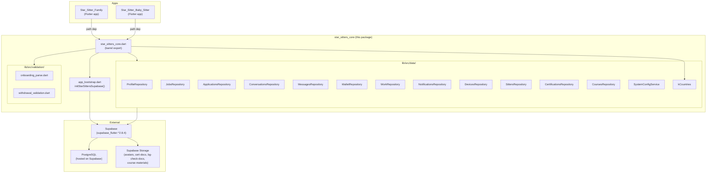
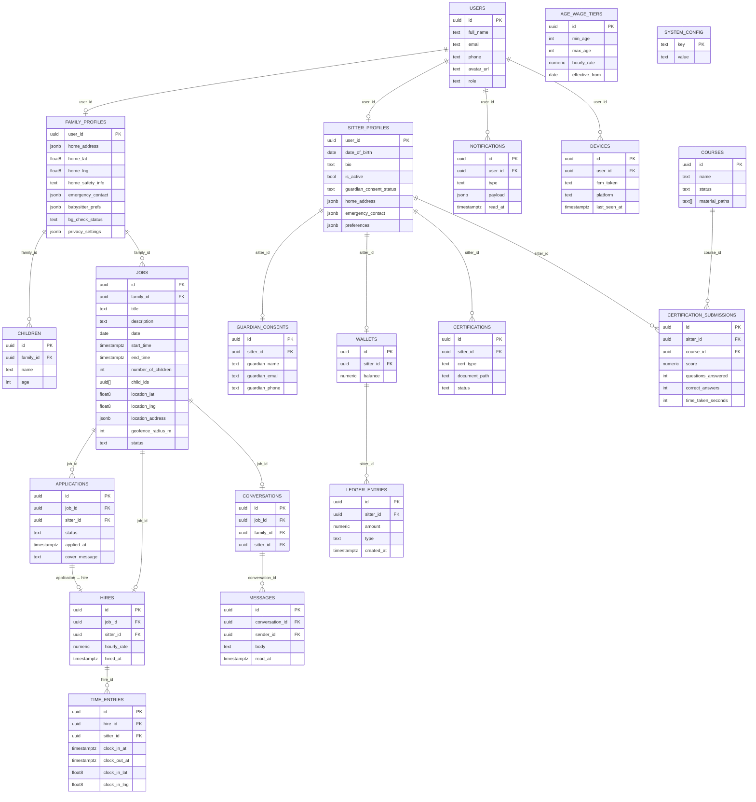
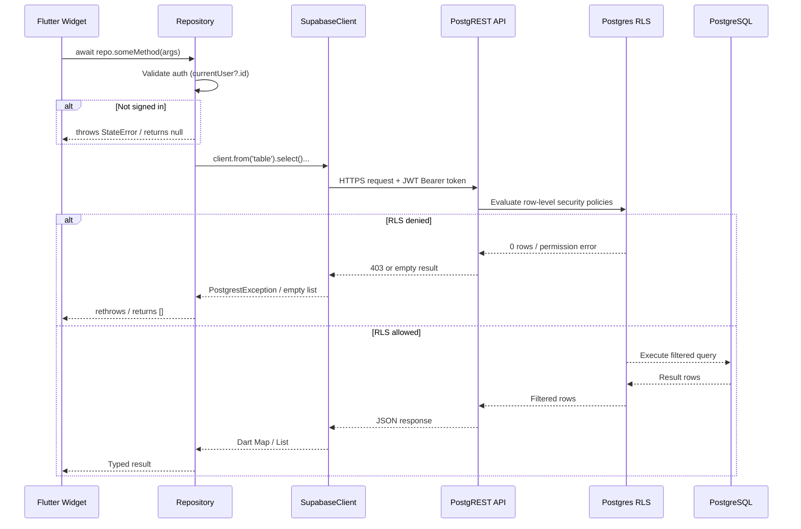
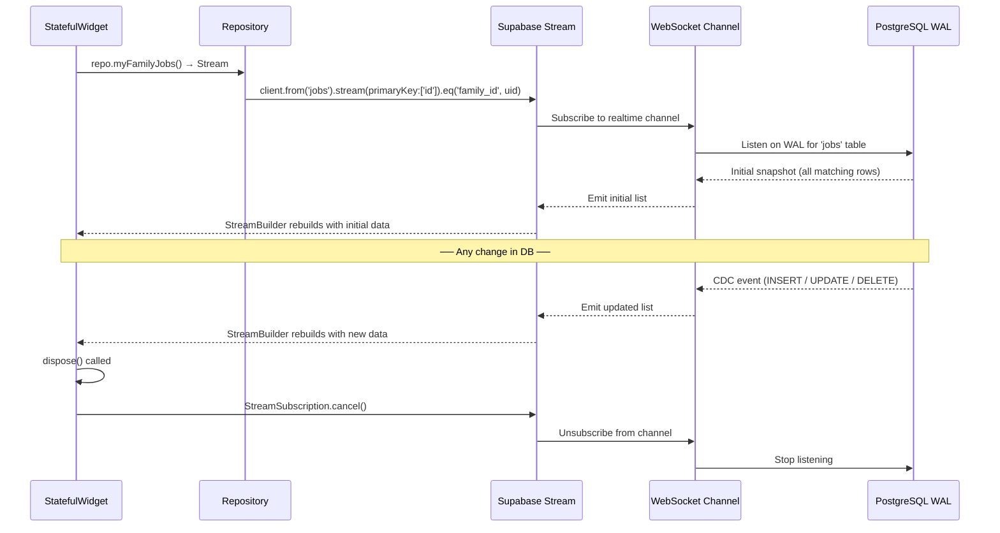
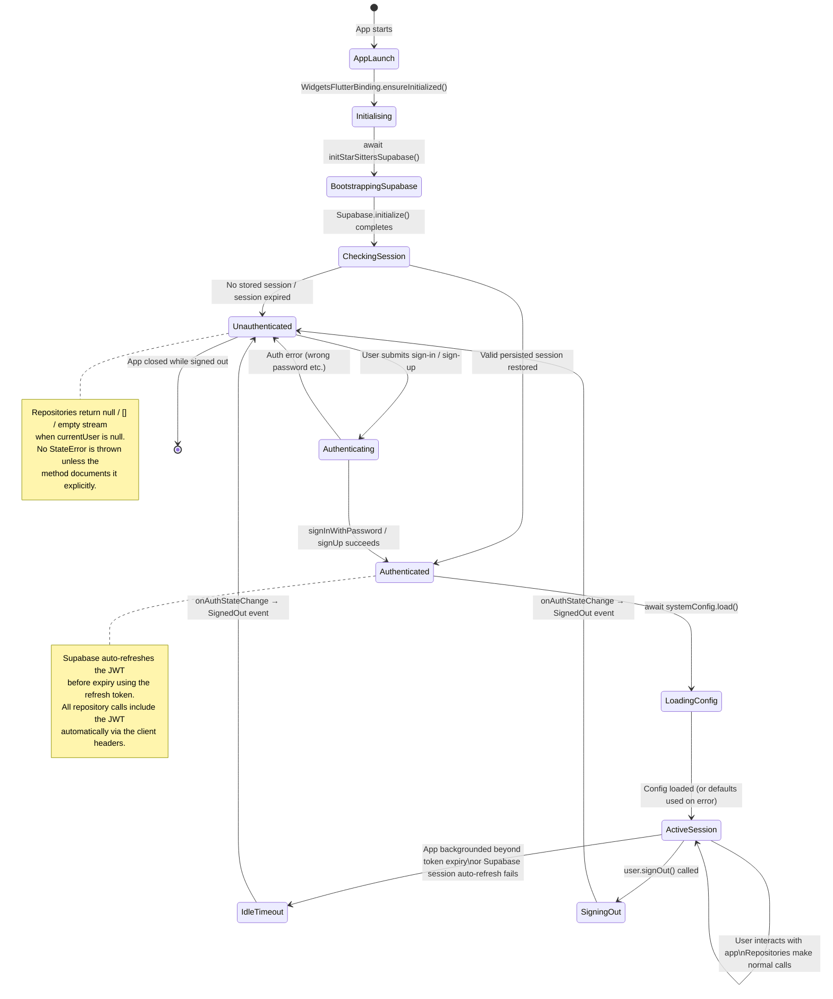

# star_sitters_core

> Shared Dart/Flutter package — centralised Supabase data access, auth bootstrap, validation, and
> runtime configuration for the **Star Sitters** platform.

Version `0.1.0` · Dart SDK `^3.9.0` · `supabase_flutter ^2.8.4` · `publish_to: none`

---

## Table of Contents

1. [Overview](#1-overview)
2. [Architecture](#2-architecture)
   - 2.1 [Package Dependency Graph](#21-package-dependency-graph)
   - 2.2 [Internal Module Map](#22-internal-module-map)
3. [Getting Started](#3-getting-started)
   - 3.1 [Adding the Path Dependency](#31-adding-the-path-dependency)
   - 3.2 [Bootstrap — initStarSittersSupabase()](#32-bootstrap--initstarsiterssupabase)
   - 3.3 [Build-Time Credentials](#33-build-time-credentials)
4. [Data Layer — Repository Overview](#4-data-layer--repository-overview)
   - 4.1 [Repository-to-Database Mapping](#41-repository-to-database-mapping)
   - 4.2 [Data Flow Diagram](#42-data-flow-diagram)
   - 4.3 [Realtime Subscription Lifecycle](#43-realtime-subscription-lifecycle)
5. [Auth State Machine](#5-auth-state-machine)
6. [API Reference](#6-api-reference)
   - 6.1 [AppBootstrap](#61-appbootstrap)
   - 6.2 [ProfileRepository](#62-profilerepository)
   - 6.3 [JobsRepository](#63-jobsrepository)
   - 6.4 [ApplicationsRepository](#64-applicationsrepository)
   - 6.5 [ConversationsRepository](#65-conversationsrepository)
   - 6.6 [MessagesRepository](#66-messagesrepository)
   - 6.7 [WalletRepository](#67-walletrepository)
   - 6.8 [WorkRepository](#68-workrepository)
   - 6.9 [NotificationsRepository](#69-notificationsrepository)
   - 6.10 [DevicesRepository](#610-devicesrepository)
   - 6.11 [SittersRepository](#611-sittersrepository)
   - 6.12 [CertificationsRepository](#612-certificationsrepository)
   - 6.13 [CoursesRepository](#613-coursesrepository)
   - 6.14 [SystemConfigService](#614-systemconfigservice)
   - 6.15 [countries.dart — kCountries](#615-countriesdart--kcountries)
7. [Validation Utilities](#7-validation-utilities)
   - 7.1 [onboarding_parse.dart](#71-onboarding_parsedart)
   - 7.2 [withdrawal_validation.dart](#72-withdrawal_validationdart)
8. [Flutter Widget Integration Examples](#8-flutter-widget-integration-examples)
   - 8.1 [Profile Screen (Family)](#81-profile-screen-family)
   - 8.2 [Job Board (Sitter Browse)](#82-job-board-sitter-browse)
   - 8.3 [Post a Job (Family)](#83-post-a-job-family)
   - 8.4 [Realtime Chat Screen](#84-realtime-chat-screen)
   - 8.5 [Wallet & Withdrawal](#85-wallet--withdrawal)
   - 8.6 [Clock In / Clock Out](#86-clock-in--clock-out)
   - 8.7 [Notifications Feed](#87-notifications-feed)
   - 8.8 [Country Picker](#88-country-picker)
   - 8.9 [Certifications Upload](#89-certifications-upload)
   - 8.10 [Course Catalog](#810-course-catalog)
9. [Testing](#9-testing)
   - 9.1 [Running Tests](#91-running-tests)
   - 9.2 [Test Coverage Summary](#92-test-coverage-summary)
   - 9.3 [Test File Reference](#93-test-file-reference)
10. [Security Model — RLS and Supabase Auth](#10-security-model--rls-and-supabase-auth)
11. [Storage Buckets](#11-storage-buckets)
12. [Supabase RPC Reference](#12-supabase-rpc-reference)
13. [SystemConfigService Runtime Keys](#13-systemconfigservice-runtime-keys)
14. [Error Handling Patterns](#14-error-handling-patterns)
15. [Contributing](#15-contributing)
16. [Changelog](#16-changelog)

---

## 1. Overview

`star_sitters_core` is a **pure path dependency** — it is never published to pub.dev. Both client
applications (`Star_Sitter_Family` and `Star_Sitter_Baby_Sitter`) declare it locally:

```yaml
dependencies:
  star_sitters_core:
    path: ../star_sitters_core
```

The package has a single responsibility: **own all Supabase I/O** so that the two apps share
identical database access logic without code duplication. Neither app calls `supabase_flutter`
directly for data operations; every query, stream, RPC call, and storage upload is expressed as a
method on one of the 13 repository classes defined here.

### What the package provides

| Category | Contents |
|---|---|
| Bootstrap | `initStarSittersSupabase()` — initialises the Supabase singleton with PKCE auth flow |
| Repositories | 13 strongly-typed repository classes (profiles, jobs, applications, messages, conversations, wallet, work, notifications, devices, sitters, certifications, courses) |
| Runtime config | `SystemConfigService` — reads `system_config` table; exposes typed getters with safe defaults |
| Validation | Two pure-Dart modules (`onboarding_parse`, `withdrawal_validation`) with no Flutter dependency |
| Data | `kCountries` — 40-country list with flag emoji, dial code, name, ISO code |

### What the package does NOT do

- It does not contain any Flutter UI widgets.
- It does not contain any app-level navigation or routing.
- It does not contain Firebase/FCM initialisation (only device token registration).
- It is not responsible for authentication flows (sign-in screens live in each app).

---

## 2. Architecture

### 2.1 Package Dependency Graph



### 2.2 Internal Module Map

```mermaid
graph LR
    subgraph "star_sitters_core/lib/"
        direction TB
        BARREL2["star_sitters_core.dart<br/>(17 exports)"]

        subgraph src_data["src/data/"]
            AB["app_bootstrap.dart"]
            PROF["profile_repository.dart"]
            JOBS["jobs_repository.dart"]
            APPS["applications_repository.dart"]
            CONV["conversations_repository.dart"]
            MSGS["messages_repository.dart"]
            WALL["wallet_repository.dart"]
            WORK["work_repository.dart"]
            NOTS["notifications_repository.dart"]
            DEVS["devices_repository.dart"]
            SITS["sitters_repository.dart"]
            CERTS["certifications_repository.dart"]
            CORS["courses_repository.dart"]
            SYSC["system_config_service.dart"]
            CTRY["countries.dart"]
        end

        subgraph src_val["src/validation/"]
            OBP["onboarding_parse.dart"]
            WDV["withdrawal_validation.dart"]
        end
    end

    BARREL2 --> AB
    BARREL2 --> PROF
    BARREL2 --> JOBS
    BARREL2 --> APPS
    BARREL2 --> CONV
    BARREL2 --> MSGS
    BARREL2 --> WALL
    BARREL2 --> WORK
    BARREL2 --> NOTS
    BARREL2 --> DEVS
    BARREL2 --> SITS
    BARREL2 --> CERTS
    BARREL2 --> CORS
    BARREL2 --> SYSC
    BARREL2 --> CTRY
    BARREL2 --> OBP
    BARREL2 --> WDV

    PROF -.->|imports| OBP
    WALL -.->|imports| WDV
    AB   -.->|imports| SYSC
```



---

## 3. Getting Started

### 3.1 Adding the Path Dependency

Both consuming apps reference the package via a relative path:

```yaml
# Star_Sitter_Family/pubspec.yaml
# Star_Sitter_Baby_Sitter/pubspec.yaml

dependencies:
  flutter:
    sdk: flutter
  star_sitters_core:
    path: ../star_sitters_core
```

Run `flutter pub get` in each app after modifying `pubspec.yaml`.

Import the barrel in any Dart file:

```dart
import 'package:star_sitters_core/star_sitters_core.dart';
```

This single import makes all 13 repositories, both validation modules, `kCountries`,
`SystemConfigService`, and `initStarSittersSupabase()` available.

### 3.2 Bootstrap — initStarSittersSupabase()

Call `initStarSittersSupabase()` once, as the first `await` in `main()`, before `runApp()`:

```dart
import 'package:flutter/material.dart';
import 'package:star_sitters_core/star_sitters_core.dart';

Future<void> main() async {
  WidgetsFlutterBinding.ensureInitialized();

  // Reads SUPABASE_URL and SUPABASE_ANON_KEY from --dart-define.
  // Throws StateError if either is empty.
  await initStarSittersSupabase();

  // Optional: pre-load runtime config flags after initialisation.
  await systemConfig.load();

  runApp(const MyApp());
}
```

What `initStarSittersSupabase()` does internally:

1. Reads `SUPABASE_URL` and `SUPABASE_ANON_KEY` from compile-time `--dart-define` values.
2. Calls `Supabase.initialize()` with `debug: kDebugMode` and `authFlowType: AuthFlowType.pkce`.
3. Assigns the global `systemConfig` late variable with a new `SystemConfigService` instance bound
   to the initialised `SupabaseClient`.

> **Important:** If `SUPABASE_URL` or `SUPABASE_ANON_KEY` is missing or empty, the function throws
> `StateError` immediately, preventing the app from starting with invalid credentials.

### 3.3 Build-Time Credentials

Credentials are injected at compile time, not stored in source:

```bash
# Development run
flutter run \
  --dart-define=SUPABASE_URL=https://your-project.supabase.co \
  --dart-define=SUPABASE_ANON_KEY=eyJ...

# Production build (Android)
flutter build apk \
  --dart-define=SUPABASE_URL=https://your-project.supabase.co \
  --dart-define=SUPABASE_ANON_KEY=eyJ...

# Production build (iOS)
flutter build ipa \
  --dart-define=SUPABASE_URL=https://your-project.supabase.co \
  --dart-define=SUPABASE_ANON_KEY=eyJ...
```

In CI/CD environments, reference these values from secrets rather than hardcoding them in pipeline
configuration files.

### Instantiating Repositories

Every repository takes a single `SupabaseClient` in its constructor. After initialisation the
client is available globally:

```dart
import 'package:supabase_flutter/supabase_flutter.dart';
import 'package:star_sitters_core/star_sitters_core.dart';

final client = Supabase.instance.client;

final profileRepo  = ProfileRepository(client);
final jobsRepo     = JobsRepository(client);
final messagesRepo = MessagesRepository(client);
// ... etc.
```

In larger apps, repositories are typically created once and injected via a DI solution (e.g.
`Provider`, `Riverpod`, `get_it`). Creating a new repository instance per widget is safe but
unnecessary.

---

## 4. Data Layer — Repository Overview

### 4.1 Repository-to-Database Mapping



**Repository ↔ Table mapping at a glance:**

| Repository | Primary Tables | Secondary Tables / Storage |
|---|---|---|
| `ProfileRepository` | `users`, `family_profiles`, `sitter_profiles` | `children`, `guardian_consents`, `avatars` bucket, `bg-check-docs` bucket |
| `JobsRepository` | `jobs` | `hires`, `age_wage_tiers` |
| `ApplicationsRepository` | `applications` | `hires`, `users` (joined) |
| `ConversationsRepository` | `conversations` | `messages` (unread count), `jobs` (title) |
| `MessagesRepository` | `messages` | — |
| `WalletRepository` | `wallets`, `ledger_entries` | — |
| `WorkRepository` | `time_entries` | `hires`, `jobs` |
| `NotificationsRepository` | `notifications` | — |
| `DevicesRepository` | `devices` | — |
| `SittersRepository` | `sitter_profiles` | `users` (inner join) |
| `CertificationsRepository` | `certifications` | `cert-docs` bucket |
| `CoursesRepository` | `courses`, `certification_submissions` | `course-materials` bucket |
| `SystemConfigService` | `system_config` | — |

### 4.2 Data Flow Diagram

The path a request takes from a Flutter widget through to PostgreSQL and back:



### 4.3 Realtime Subscription Lifecycle

Repositories that return `Stream<...>` use Supabase's `.stream()` API, which creates a persistent
WebSocket channel to Postgres logical replication:



**Key points about realtime streams in this package:**

- All streams return `const Stream.empty()` when the user is not signed in, preventing null errors.
- Streams are backed by `supabase_flutter`'s `.stream()` which applies the same RLS filters as
  one-shot queries — a user can only receive their own rows.
- Cancel subscriptions in `dispose()` to avoid memory leaks. `StreamBuilder` handles cancellation
  automatically when the widget is removed from the tree.
- The `.stream()` API emits the full filtered list on every change, not just the changed row.
  Widgets must call `setState` (or equivalent) only when the new list actually differs if
  performance is critical for long lists.

---

## 5. Auth State Machine

The Supabase auth state drives all repository behaviour. The state machine below represents the
lifecycle from cold launch through idle timeout to sign-out:



**Listening to auth state changes in a widget:**

```dart
import 'package:supabase_flutter/supabase_flutter.dart';

class _MyHomeState extends State<MyHome> {
  late final StreamSubscription<AuthState> _authSub;

  @override
  void initState() {
    super.initState();
    _authSub = Supabase.instance.client.auth.onAuthStateChange.listen((data) {
      final event = data.event;
      if (event == AuthChangeEvent.signedOut) {
        Navigator.of(context).pushReplacementNamed('/login');
      }
    });
  }

  @override
  void dispose() {
    _authSub.cancel();
    super.dispose();
  }
}
```

---

## 6. API Reference

All repositories follow the same constructor pattern:

```dart
RepositoryName(SupabaseClient client)
```

The `client` is the singleton `Supabase.instance.client` obtained after calling
`initStarSittersSupabase()`.

---

### 6.1 AppBootstrap

**File:** `lib/src/app_bootstrap.dart`
**Exports:** `initStarSittersSupabase()`, `systemConfig`

<details>
<summary>Full API table and notes</summary>

| Symbol | Kind | Signature | Description |
|---|---|---|---|
| `initStarSittersSupabase` | `Future<void>` function | `Future<void> initStarSittersSupabase()` | Initialises Supabase singleton. Reads `SUPABASE_URL` and `SUPABASE_ANON_KEY` from `--dart-define`. Throws `StateError` if either is empty. Sets the global `systemConfig` late field. |
| `systemConfig` | `late final SystemConfigService` | — | Global accessor for runtime configuration. Only valid after `initStarSittersSupabase()` resolves. |

**Auth options applied:**

```dart
authOptions: const FlutterAuthClientOptions(
  authFlowType: AuthFlowType.pkce,
),
```

PKCE (Proof Key for Code Exchange) prevents auth code interception attacks in mobile deep-link
flows. All Supabase email magic-link and OAuth redirects go through PKCE in this package.

</details>

---

### 6.2 ProfileRepository

**File:** `lib/src/data/profile_repository.dart`

Manages the three core identity tables (`users`, `family_profiles`, `sitter_profiles`) plus
children, guardian consents, avatar uploads, and background-check document submission.

<details>
<summary>Complete method reference</summary>

| Method | Return Type | Description | Auth Required |
|---|---|---|---|
| `currentUserRow()` | `Future<Map<String,dynamic>?>` | Reads the signed-in user's row from `public.users`. Returns `null` if not signed in or row missing. | Yes (returns null if absent) |
| `familyProfile()` | `Future<Map<String,dynamic>?>` | Reads the signed-in user's `family_profiles` row. Returns `null` if not found. | Yes |
| `sitterProfile()` | `Future<Map<String,dynamic>?>` | Reads the signed-in user's `sitter_profiles` row. Returns `null` if not found. | Yes |
| `updateCurrentUser({fullName, phone})` | `Future<void>` | Updates allowed fields on `public.users` (own row). Skips empty payload. Throws `StateError` if not signed in. | Yes — throws |
| `updateFamily({homeAddress, homeLat, homeLng, homeSafetyInfo, emergencyContact, babysitterPrefs})` | `Future<void>` | Partial update of `family_profiles`. All parameters optional; only non-null fields are written. Throws `StateError` if not signed in. | Yes — throws |
| `updateSitterBio(String bio)` | `Future<void>` | Updates `sitter_profiles.bio`. Throws `ArgumentError` if `bio.length > 500`. | Yes — throws |
| `updateSitterAddress(Map<String,dynamic> address)` | `Future<void>` | Updates `sitter_profiles.home_address` (JSONB). | Yes — throws |
| `updateSitterEmergencyContact(Map<String,dynamic> contact)` | `Future<void>` | Updates `sitter_profiles.emergency_contact` (JSONB). | Yes — throws |
| `getSitterPreferences()` | `Future<Map<String,dynamic>>` | Reads `sitter_profiles.preferences` JSONB. Returns `{}` if not signed in or field is null. | Soft (returns {}) |
| `saveSitterPreferences(Map<String,dynamic> prefs)` | `Future<void>` | Writes `sitter_profiles.preferences`. | Yes — throws |
| `getFamilyPrivacySettings()` | `Future<Map<String,dynamic>>` | Reads `family_profiles.privacy_settings` JSONB. Returns `{}` if missing. | Soft (returns {}) |
| `saveFamilyPrivacySettings(Map<String,dynamic> settings)` | `Future<void>` | Writes `family_profiles.privacy_settings`. | Yes — throws |
| `mergeFamilyBabysitterPrefs(Map<String,dynamic> patch)` | `Future<void>` | Reads existing `babysitter_prefs`, shallow-merges `patch`, then calls `updateFamily`. | Yes — throws |
| `listFamilyChildren()` | `Future<List<Map<String,dynamic>>>` | Returns all `children` rows for the signed-in family, ordered by `created_at` ascending. Returns `[]` if not signed in. | Soft (returns []) |
| `replaceFamilyChildren(List<Map<String,Object>> rows)` | `Future<void>` | Deletes all existing children then inserts `rows`. Transactional within a single Supabase request pair. Throws `StateError` if not signed in. | Yes — throws |
| `uploadAvatar(Uint8List bytes, String filename)` | `Future<String>` | Uploads bytes to `avatars/<uid>/avatar.<ext>` (upsert). Updates `users.avatar_url`. Returns public URL. Throws `StateError` if not signed in. | Yes — throws |
| `uploadFamilyBgCheckBytes(Uint8List bytes, String filename)` | `Future<String>` | Uploads to `bg-check-docs/<uid>/<timestamp>_<safe_name>`. Returns storage path (not a public URL). | Yes — throws |
| `submitBackgroundCheck(List documents)` | `Future<void>` | Calls RPC `family_submit_background_check` with document paths. Sets `bg_check_status` to pending server-side. | Yes — throws |
| `ensureGuardianConsentRow({guardianName, guardianEmail, guardianPhone?})` | `Future<void>` | Inserts a `guardian_consents` row once per sitter (no-op if row already exists). Triggers email webhook server-side. | Yes — throws |
| `submitCertification({courseId, score?, questionsAnswered?, correctAnswers?, timeTakenSeconds?})` | `Future<void>` | Calls RPC `sitter_submit_certification`. Use only when a published `courses` row exists. | Yes — throws |
| `watchFamilyProfileRow()` | `Stream<Map<String,dynamic>?>` | Realtime stream of the family's `family_profiles` row. Emits `null` when row missing. Returns empty stream if not signed in. | Soft (empty stream) |
| `watchSitterProfileRow()` | `Stream<Map<String,dynamic>?>` | Realtime stream of the sitter's `sitter_profiles` row. Used to gate UI on `is_active` status. | Soft (empty stream) |
| `static parseOnboardingChildrenRecords({countStr, agesStr})` | `List<Map<String,Object>>` | Static delegator to `parseFamilyOnboardingChildrenRecords`. Parses onboarding wizard input into DB row format. | None (static) |

</details>

---

### 6.3 JobsRepository

**File:** `lib/src/data/jobs_repository.dart`

Manages the `jobs` table — creation, status updates, lookups, and associated wage tier queries.

<details>
<summary>Complete method reference</summary>

| Method | Return Type | Description | Auth Required |
|---|---|---|---|
| `myFamilyJobs()` | `Stream<List<Map<String,dynamic>>>` | Realtime stream of all jobs belonging to the signed-in family (`family_id = uid`). Returns empty stream if not signed in. | Soft (empty stream) |
| `openJobs({int limit = 50})` | `Future<List<Map<String,dynamic>>>` | One-shot query for all `status = 'open'` jobs, newest first. Used in the sitter browse feed. Returns partial columns only (no geofence details). | None — public RLS policy |
| `createJob({title, description?, date, startTime, endTime, numberOfChildren, locationLat, locationLng, locationAddress?, geofenceRadiusM?, childIds?})` | `Future<Map<String,dynamic>>` | Inserts a new job with `status = 'open'`. Dates stored as ISO-8601. Returns full inserted row. Throws `StateError` if not signed in. | Yes — throws |
| `cancelJob(String jobId)` | `Future<void>` | Sets `jobs.status = 'cancelled'`. Verifies ownership via double `.eq('family_id', uid)`. Throws `StateError` if job not found or not owned. | Yes — throws |
| `getJob(String jobId)` | `Future<Map<String,dynamic>?>` | Fetches a single job by `id`. Returns `null` if not found. RLS determines visibility. | RLS-filtered |
| `hireForJob(String jobId)` | `Future<Map<String,dynamic>?>` | Fetches the single `hires` row for a job. Used by family to check hire status. | RLS-filtered |
| `hourlyRateForAge(int age)` | `Future<double?>` | Queries `age_wage_tiers` for the applicable rate for a sitter's age on today's date. Returns `null` if no tier matches. | None — public |
| `countMySitterApplications()` | `Future<int>` | Counts all application rows for the signed-in sitter. Returns `0` if not signed in. | Soft (returns 0) |
| `sitterHireHistoryWithJobs()` | `Future<List<Map<String,dynamic>>>` | Returns sitter's `hires` rows with nested `jobs` data. Ordered by `hired_at` descending. | Soft (returns []) |

**Job status values:**

| Value | Description |
|---|---|
| `open` | Posted and accepting applications |
| `hired` | A sitter has been accepted; awaiting clock-in |
| `active` | Sitter has clocked in |
| `completed` | Clock-out confirmed |
| `cancelled` | Cancelled by family |

</details>

---

### 6.4 ApplicationsRepository

**File:** `lib/src/data/applications_repository.dart`

Manages the full application lifecycle — sitter applies, family reviews, family hires or family
does a direct hire.

<details>
<summary>Complete method reference</summary>

| Method | Return Type | Description | Auth Required |
|---|---|---|---|
| `createApplication({jobId, coverMessage?})` | `Future<Map<String,dynamic>>` | Calls RPC `create_application`. Server validates sitter eligibility (age, active status, no duplicate). Returns the new application row as a map. | Yes |
| `withdraw(String applicationId)` | `Future<void>` | Calls RPC `withdraw_application`. Server validates ownership. | Yes |
| `hire(String applicationId)` | `Future<String>` | Calls RPC `create_hire`. Returns new hire ID. Server atomically creates hire, updates job status to `hired`, and closes other applications. | Yes |
| `directHire({sitterId, date, startTime, endTime, numberOfChildren?, title?})` | `Future<Map<String,dynamic>>` | Calls RPC `family_direct_hire`. Atomically creates job + application + hire in one server transaction. Used when family browses sitter cards and hires without a job posting. | Yes |
| `applicationsForJob(String jobId)` | `Stream<List<Map<String,dynamic>>>` | Realtime stream of all applications on a specific job. For family review screen. | RLS-filtered |
| `mySitterApplications()` | `Stream<List<Map<String,dynamic>>>` | Realtime stream of the signed-in sitter's own applications. | Soft (empty stream) |
| `fetchMyApplicationsWithJobs()` | `Future<List<Map<String,dynamic>>>` | One-shot list of sitter applications with nested `jobs` row per entry. Ordered by `applied_at` descending. | Soft (returns []) |
| `applicationsWithSitterUsers(String jobId)` | `Future<List<Map<String,dynamic>>>` | One-shot list of applications enriched with `sitter_user` map (`full_name`, `email`). Used on family's applicant review screen. | Yes |

**Application status values:**

| Value | Description |
|---|---|
| `pending` | Sitter applied, awaiting family decision |
| `hired` | Family hired this sitter via this application |
| `withdrawn` | Sitter withdrew the application |
| `rejected` | Family chose another applicant (set server-side) |

</details>

---

### 6.5 ConversationsRepository

**File:** `lib/src/data/conversations_repository.dart`

Manages the `conversations` table. Conversations are created server-side when a hire is confirmed.

<details>
<summary>Complete method reference</summary>

| Method | Return Type | Description | Auth Required |
|---|---|---|---|
| `familyConversations()` | `Stream<List<Map<String,dynamic>>>` | Realtime stream of all conversations where `family_id = uid`. Used in the family messaging inbox. | Soft (empty stream) |
| `sitterConversations()` | `Stream<List<Map<String,dynamic>>>` | Realtime stream of all conversations where `sitter_id = uid`. Used in the sitter messaging inbox. | Soft (empty stream) |
| `conversationIdForJob(String jobId)` | `Future<String?>` | Looks up the conversation linked to a specific job. Returns `null` if none. | RLS-filtered |
| `fetchJobTitle(String jobId)` | `Future<Map<String,dynamic>?>` | Convenience lookup for `jobs.title` given a job ID. Returns `null` if not found. | RLS-filtered |
| `unreadCountForConversation(String conversationId)` | `Future<int>` | Counts messages in the conversation where `sender_id != currentUser.id` AND `read_at IS NULL`. Returns `0` if not signed in. | Soft (returns 0) |

</details>

---

### 6.6 MessagesRepository

**File:** `lib/src/data/messages_repository.dart`

Sends and receives individual chat messages within a conversation.

<details>
<summary>Complete method reference</summary>

| Method | Return Type | Description | Auth Required |
|---|---|---|---|
| `stream(String conversationId)` | `Stream<List<Map<String,dynamic>>>` | Realtime stream of all messages in a conversation. Messages arrive in insertion order. Emits full list on every new message. | RLS-filtered |
| `send({conversationId, body})` | `Future<void>` | Inserts a new `messages` row with `sender_id = currentUser.id`. Throws `StateError` if not signed in. | Yes — throws |
| `markRead(String messageId)` | `Future<void>` | Sets `messages.read_at` to current UTC timestamp. Idempotent — calling twice just overwrites with a newer timestamp. | RLS-filtered |

</details>

---

### 6.7 WalletRepository

**File:** `lib/src/data/wallet_repository.dart`

Manages the sitter's earnings wallet. Wallets are created server-side when a sitter profile is
first activated.

<details>
<summary>Complete method reference</summary>

| Method | Return Type | Description | Auth Required |
|---|---|---|---|
| `myWallet()` | `Future<Map<String,dynamic>?>` | One-shot read of the signed-in sitter's `wallets` row. Returns `null` if not signed in or wallet row absent. | Soft (returns null) |
| `ledgerStream()` | `Stream<List<Map<String,dynamic>>>` | Realtime stream of all `ledger_entries` for the current sitter. Entries are ordered by `created_at` ascending (insertion order). | Soft (empty stream) |
| `requestWithdrawal({amount, method, accountInfo?, availableBalance?})` | `Future<String>` | Optionally validates amount client-side using `validateWithdrawalRequest`, then calls RPC `request_withdrawal`. Returns the created withdrawal request ID as a string. Throws `ArgumentError` if client-side validation fails. | Yes |

**Withdrawal methods** (passed as `method` string — values are defined by your backend):

Common values: `'bank_transfer'`, `'paypal'`, `'jazzcash'`, `'easypaisa'`

**Ledger entry types** (defined server-side):

| Type | Description |
|---|---|
| `credit` | Earnings added after job completion |
| `withdrawal` | Amount deducted on withdrawal request |
| `adjustment` | Admin manual adjustment |

</details>

---

### 6.8 WorkRepository

**File:** `lib/src/data/work_repository.dart`

Manages clock-in/clock-out operations and time entry queries. Geofence validation happens
entirely on the server via the RPC functions.

<details>
<summary>Complete method reference</summary>

| Method | Return Type | Description | Auth Required |
|---|---|---|---|
| `clockIn({hireId, lat, lng})` | `Future<Map<String,dynamic>>` | Calls RPC `clock_in`. Server validates that `(lat, lng)` is within the job's geofence radius. Creates a `time_entries` row, sets job status to `active`. Returns result map from RPC. | Yes |
| `clockOut({hireId, lat, lng})` | `Future<Map<String,dynamic>>` | Calls RPC `clock_out`. Server closes the open `time_entries` row, calculates wages earned, credits the sitter's wallet, sets job status to `completed`. Returns result map. | Yes |
| `hireIdAwaitingClockIn()` | `Future<String?>` | Searches the sitter's hires for one where `jobs.status = 'hired'` and no open time entry exists. Returns hire ID or `null`. Used to show "Ready to clock in" prompt. | Soft (returns null) |
| `hireIdWithOpenClockIn()` | `Future<String?>` | Searches `time_entries` for a row where `sitter_id = uid` and `clock_out_at IS NULL`. Returns hire ID or `null`. Used to show "Clock out" button. | Soft (returns null) |

**Geofence behaviour:** The `geofence_radius_m` column on the `jobs` table (default 150 metres)
is enforced by the `clock_in` RPC using PostGIS point-in-radius calculation. If the sitter is
outside the radius the RPC raises a Postgres exception which surfaces as a `PostgrestException`
in Dart.

</details>

---

### 6.9 NotificationsRepository

**File:** `lib/src/data/notifications_repository.dart`

Manages in-app notifications. Notifications are created server-side by database triggers and
edge functions.

<details>
<summary>Complete method reference</summary>

| Method | Return Type | Description | Auth Required |
|---|---|---|---|
| `myNotifications()` | `Stream<List<Map<String,dynamic>>>` | Realtime stream of all notifications for the signed-in user (`user_id = uid`). Returns empty stream if not signed in. | Soft (empty stream) |
| `markRead(String notificationId)` | `Future<void>` | Sets `notifications.read_at` to current UTC timestamp for a single notification. | RLS-filtered |
| `markAllRead()` | `Future<void>` | Calls RPC `mark_all_notifications_read`. Server updates all unread notifications for the current user. | Yes |

</details>

---

### 6.10 DevicesRepository

**File:** `lib/src/data/devices_repository.dart`

Registers FCM push notification tokens. Call this after the user signs in and after Firebase
Messaging provides a token or token refresh event.

<details>
<summary>Complete method reference</summary>

| Method | Return Type | Description | Auth Required |
|---|---|---|---|
| `registerFcmToken({token, platform})` | `Future<void>` | Upserts a `devices` row using the conflict key `(user_id, fcm_token)`. Updates `last_seen_at` on each call. Safe to call on every app launch after sign-in. Returns silently if user is not signed in. `platform` defaults to `'android'`. | Soft (no-op) |

**Platform values:**

| Value | Platform |
|---|---|
| `'android'` | Android (default) |
| `'ios'` | iOS |
| `'web'` | Web PWA |

</details>

---

### 6.11 SittersRepository

**File:** `lib/src/data/sitters_repository.dart`

Public sitter discovery for the family app. Only sitters with `is_active = true` are returned.
This flag is controlled by admins, not sitters.

<details>
<summary>Complete method reference</summary>

| Method | Return Type | Description | Auth Required |
|---|---|---|---|
| `listActiveSitters({int limit = 50})` | `Future<List<Map<String,dynamic>>>` | Queries `sitter_profiles` inner-joined with `users`. Returns `user_id`, `bio`, `date_of_birth`, `guardian_consent_status`, `full_name`, `email`, `avatar_url`. Ordered by `updated_at` descending. | RLS-filtered |
| `getSitterPublicBundle(String sitterUserId)` | `Future<Map<String,dynamic>?>` | Fetches one sitter profile with user data for the family's sitter detail card. Returns `null` if sitter is not active or not found. | RLS-filtered |

</details>

---

### 6.12 CertificationsRepository

**File:** `lib/src/data/certifications_repository.dart`

Manages sitter certification documents and their status lifecycle.

<details>
<summary>Complete method reference</summary>

| Method | Return Type | Description | Auth Required |
|---|---|---|---|
| `myCertificationsStream()` | `Stream<List<Map<String,dynamic>>>` | Realtime stream of all `certifications` rows for the current sitter. Returns empty stream if not signed in. | Soft (empty stream) |
| `uploadCertificationDocument({bytes, filename, certType})` | `Future<void>` | Uploads bytes to `cert-docs/<uid>/<timestamp>_<safe_name>` then calls RPC `register_certification_document`. Server creates a `certifications` row with `status = 'pending_review'`. | Yes — throws |
| `signedCertDocumentUrl(String documentPath, {int expiresInSeconds = 3600})` | `Future<String>` | Creates a signed URL for the sitter's own document. Appends `?download=true` to prevent inline execution (security measure). Validates that `documentPath` starts with `<uid>/`. | Yes — throws |

**Certification status values** (set server-side):

| Value | Description |
|---|---|
| `pending_review` | Uploaded, awaiting admin review |
| `approved` | Admin verified the document |
| `rejected` | Admin rejected; sitter may resubmit |

**Supported file types** for upload: `.jpg`, `.jpeg`, `.png`, `.pdf`

</details>

---

### 6.13 CoursesRepository

**File:** `lib/src/data/courses_repository.dart`

Sitter learning content — published courses, signed material URLs, and completion tracking via
`certification_submissions`.

<details>
<summary>Complete method reference</summary>

| Method | Return Type | Description | Auth Required |
|---|---|---|---|
| `publishedCoursesStream()` | `Stream<List<Map<String,dynamic>>>` | Realtime stream of all `courses` rows where `status = 'published'`, ordered by `name`. | None — public |
| `getSignedUrl(String storagePath)` | `Future<String?>` | Creates a 1-hour signed URL for a file in the `course-materials` bucket. Returns `null` on any error (bucket not found, path invalid). | Yes (Supabase RLS on bucket) |
| `myCompletedCourseIds()` | `Future<List<Map<String,dynamic>>>` | Returns `certification_submissions` rows where `sitter_id = uid` and `score >= 80`. Each row contains `course_id`. Returns `[]` if not signed in. | Soft (returns []) |

**Completion threshold:** Score must be `>= 80` (out of 100) to count as a completed course.

</details>

---

### 6.14 SystemConfigService

**File:** `lib/src/data/system_config_service.dart`
**Global accessor:** `systemConfig` (set by `initStarSittersSupabase()`)

Runtime feature flags and operational parameters stored in the `system_config` table
(`key TEXT PRIMARY KEY, value TEXT`). Allows changing platform behaviour without app redeployment.

<details>
<summary>Complete reference</summary>

**Constructor:** `SystemConfigService(SupabaseClient client)`

**Public fields with defaults:**

| Field | Type | Default | DB Key | Description |
|---|---|---|---|---|
| `minSitterAge` | `int` | `13` | `min_sitter_age` | Minimum age a sitter must be to register |
| `maxJobDurationHours` | `int` | `8` | `max_job_duration_hours` | Maximum clock-in to clock-out duration enforced by RPC |
| `gpsTrackingMode` | `String` | `'required'` | `gps_tracking_mode` | Whether GPS is required (`'required'`) or optional (`'optional'`) for clock-in |

**Methods:**

| Method | Return Type | Description |
|---|---|---|
| `load()` | `Future<void>` | Fetches all rows from `system_config` and populates the public fields. Silently uses defaults on network or parse errors. Safe to call multiple times. |

**Usage:**

```dart
// After initStarSittersSupabase() and systemConfig.load():
if (systemConfig.gpsTrackingMode == 'required') {
  // enforce location permission before clock-in
}
final maxHours = systemConfig.maxJobDurationHours; // 8 by default
final minAge   = systemConfig.minSitterAge;         // 13 by default
```

**Graceful degradation:** If the `system_config` table is unavailable (network failure, cold
start with no connectivity), all fields retain their hardcoded defaults. Apps remain functional
with conservative default values.

</details>

---

### 6.15 countries.dart — kCountries

**File:** `lib/src/data/countries.dart`

A compile-time constant list of 40 countries for phone number country-code pickers and address
forms.

<details>
<summary>Country class definition and full country list</summary>

**The `Country` class:**

```dart
class Country {
  final String name;     // e.g. 'United Kingdom'
  final String flag;     // emoji e.g. '🇬🇧'
  final String dialCode; // e.g. '+44'
  final String code;     // ISO 3166-1 alpha-2 e.g. 'GB'
  const Country({
    required this.name,
    required this.flag,
    required this.dialCode,
    required this.code,
  });
}
```

**All 40 entries in `kCountries`:**

| Code | Name | Dial Code | Flag |
|---|---|---|---|
| US | United States | +1 | 🇺🇸 |
| GB | United Kingdom | +44 | 🇬🇧 |
| PK | Pakistan | +92 | 🇵🇰 |
| CA | Canada | +1 | 🇨🇦 |
| AU | Australia | +61 | 🇦🇺 |
| IN | India | +91 | 🇮🇳 |
| AE | UAE | +971 | 🇦🇪 |
| SA | Saudi Arabia | +966 | 🇸🇦 |
| DE | Germany | +49 | 🇩🇪 |
| FR | France | +33 | 🇫🇷 |
| IT | Italy | +39 | 🇮🇹 |
| ES | Spain | +34 | 🇪🇸 |
| NL | Netherlands | +31 | 🇳🇱 |
| SE | Sweden | +46 | 🇸🇪 |
| NO | Norway | +47 | 🇳🇴 |
| DK | Denmark | +45 | 🇩🇰 |
| CH | Switzerland | +41 | 🇨🇭 |
| TR | Turkey | +90 | 🇹🇷 |
| CN | China | +86 | 🇨🇳 |
| JP | Japan | +81 | 🇯🇵 |
| KR | South Korea | +82 | 🇰🇷 |
| SG | Singapore | +65 | 🇸🇬 |
| MY | Malaysia | +60 | 🇲🇾 |
| ID | Indonesia | +62 | 🇮🇩 |
| PH | Philippines | +63 | 🇵🇭 |
| BD | Bangladesh | +880 | 🇧🇩 |
| NG | Nigeria | +234 | 🇳🇬 |
| EG | Egypt | +20 | 🇪🇬 |
| ZA | South Africa | +27 | 🇿🇦 |
| KE | Kenya | +254 | 🇰🇪 |
| BR | Brazil | +55 | 🇧🇷 |
| MX | Mexico | +52 | 🇲🇽 |
| AR | Argentina | +54 | 🇦🇷 |
| CO | Colombia | +57 | 🇨🇴 |
| PT | Portugal | +351 | 🇵🇹 |
| IE | Ireland | +353 | 🇮🇪 |
| NZ | New Zealand | +64 | 🇳🇿 |
| RU | Russia | +7 | 🇷🇺 |
| PL | Poland | +48 | 🇵🇱 |
| UA | Ukraine | +380 | 🇺🇦 |

</details>

---

## 7. Validation Utilities

Both modules are pure Dart with zero Flutter or Supabase dependencies. They can be unit-tested
without `flutter_test` bindings if needed (though the project uses `flutter_test` for
convenience).

### 7.1 onboarding_parse.dart

**File:** `lib/src/validation/onboarding_parse.dart`

<details>
<summary>API and behaviour details</summary>

**Function signature:**

```dart
List<Map<String, Object>> parseFamilyOnboardingChildrenRecords({
  required String countStr,
  required String agesStr,
})
```

**Purpose:** The family onboarding wizard collects two text field values — how many children the
family has, and their ages as a comma-separated string. This function converts those raw strings
into a list of row payloads ready for insertion into the `children` table.

**Parameter details:**

| Parameter | Type | Description |
|---|---|---|
| `countStr` | `String` | The number of children as a string (e.g. `'3'`). Leading/trailing whitespace is trimmed. Non-integer or zero/negative values produce an empty list. |
| `agesStr` | `String` | Comma-separated ages (e.g. `'4, 6, 9'`). Each token is trimmed. Ages outside `0–18` are silently filtered. Non-numeric tokens are silently ignored. |

**Output row format:**

```dart
{'name': 'Child 1', 'age': 4}  // name is auto-generated
```

**Age padding rules:**

- If `agesStr` provides fewer valid ages than `countStr` specifies, missing ages are filled with
  the last valid age in the list.
- If `agesStr` contains no valid ages at all, the default age of `8` is used for all children.
- Ages `0` and `18` are both valid boundary values and are preserved.

**Examples:**

```dart
parseFamilyOnboardingChildrenRecords(countStr: '3', agesStr: '4, 6, 9')
// [{'name': 'Child 1', 'age': 4}, {'name': 'Child 2', 'age': 6}, {'name': 'Child 3', 'age': 9}]

parseFamilyOnboardingChildrenRecords(countStr: '3', agesStr: '10')
// [{'name': 'Child 1', 'age': 10}, {'name': 'Child 2', 'age': 10}, {'name': 'Child 3', 'age': 10}]

parseFamilyOnboardingChildrenRecords(countStr: '2', agesStr: '99, -1, abc')
// [{'name': 'Child 1', 'age': 8}, {'name': 'Child 2', 'age': 8}]

parseFamilyOnboardingChildrenRecords(countStr: '0', agesStr: '5')
// []
```

This function is also accessible as a static method on `ProfileRepository`:

```dart
ProfileRepository.parseOnboardingChildrenRecords(countStr: countStr, agesStr: agesStr)
```

</details>

### 7.2 withdrawal_validation.dart

**File:** `lib/src/validation/withdrawal_validation.dart`

<details>
<summary>API and behaviour details</summary>

**Constants:**

| Name | Value | Description |
|---|---|---|
| `kDefaultWithdrawalMinAmount` | `10.0` | Minimum withdrawal amount in the platform currency |
| `kDefaultWithdrawalFeeRate` | `0.02` | 2% fee applied to withdrawal amount |

**Functions:**

```dart
String? validateWithdrawalRequest({
  required double amount,
  required double available,
  double minAmount = kDefaultWithdrawalMinAmount,
  double feeRate = kDefaultWithdrawalFeeRate,
})
```

Returns `null` if the withdrawal is valid, or a short user-visible error message string.

**Validation rules in order:**

1. `amount` must be finite and not NaN → `'Enter a valid withdrawal amount.'`
2. `amount` must be > 0 → `'Enter a valid withdrawal amount.'`
3. `amount` must be >= `minAmount` (default 10) → `'Minimum withdrawal is $10.'`
4. `amount + amount * feeRate` must be <= `available + 1e-6` (floating-point tolerance) → `'Amount plus fee exceeds available balance.'`

```dart
double withdrawalFee(double amount, {double feeRate = kDefaultWithdrawalFeeRate})
```
Returns the fee for a given amount (`amount * feeRate`).

```dart
double withdrawalTotalDebit(double amount, {double feeRate = kDefaultWithdrawalFeeRate})
```
Returns the total deducted from the wallet (`amount + fee`).

```dart
double parseWalletAvailableBalance(dynamic raw)
```
Safely converts a raw DB value (could be `int`, `double`, `String`, or `null`) to a `double`.
Returns `0.0` for null or unparseable values.

**Usage in WalletRepository:**

```dart
final err = validateWithdrawalRequest(
  amount: amount,
  available: availableBalance,
);
if (err != null) throw ArgumentError(err);
```

</details>

---

## 8. Flutter Widget Integration Examples

The examples below show how to wire each repository into a real Flutter widget. All examples
assume repositories are created from the global Supabase client. In production, use a
dependency-injection layer.

### 8.1 Profile Screen (Family)

<details>
<summary>Full widget example — FamilyProfileScreen</summary>

```dart
import 'package:flutter/material.dart';
import 'package:supabase_flutter/supabase_flutter.dart';
import 'package:star_sitters_core/star_sitters_core.dart';

class FamilyProfileScreen extends StatefulWidget {
  const FamilyProfileScreen({super.key});

  @override
  State<FamilyProfileScreen> createState() => _FamilyProfileScreenState();
}

class _FamilyProfileScreenState extends State<FamilyProfileScreen> {
  final _repo = ProfileRepository(Supabase.instance.client);

  Map<String, dynamic>? _user;
  Map<String, dynamic>? _family;
  List<Map<String, dynamic>> _children = [];
  bool _loading = true;

  @override
  void initState() {
    super.initState();
    _load();
  }

  Future<void> _load() async {
    final results = await Future.wait([
      _repo.currentUserRow(),
      _repo.familyProfile(),
      _repo.listFamilyChildren(),
    ]);
    if (!mounted) return;
    setState(() {
      _user     = results[0] as Map<String, dynamic>?;
      _family   = results[1] as Map<String, dynamic>?;
      _children = results[2] as List<Map<String, dynamic>>;
      _loading  = false;
    });
  }

  Future<void> _updateName(String name) async {
    try {
      await _repo.updateCurrentUser(fullName: name);
      if (!mounted) return;
      ScaffoldMessenger.of(context)
          .showSnackBar(const SnackBar(content: Text('Name updated')));
      _load();
    } on StateError catch (e) {
      ScaffoldMessenger.of(context)
          .showSnackBar(SnackBar(content: Text(e.message)));
    }
  }

  @override
  Widget build(BuildContext context) {
    if (_loading) return const Center(child: CircularProgressIndicator());
    return ListView(
      padding: const EdgeInsets.all(16),
      children: [
        Text('Name: ${_user?['full_name'] ?? '—'}'),
        Text('Email: ${_user?['email'] ?? '—'}'),
        Text('Children: ${_children.length}'),
        for (final child in _children)
          ListTile(
            title: Text(child['name'] as String),
            subtitle: Text('Age ${child['age']}'),
          ),
        ElevatedButton(
          onPressed: () => _updateName('New Name'),
          child: const Text('Update Name'),
        ),
      ],
    );
  }
}
```

**Realtime profile banner using `watchFamilyProfileRow()`:**

```dart
class BgCheckBanner extends StatelessWidget {
  const BgCheckBanner({super.key});

  @override
  Widget build(BuildContext context) {
    final repo = ProfileRepository(Supabase.instance.client);
    return StreamBuilder<Map<String, dynamic>?>(
      stream: repo.watchFamilyProfileRow(),
      builder: (context, snapshot) {
        final status = snapshot.data?['bg_check_status'] as String?;
        if (status == null || status == 'approved') return const SizedBox.shrink();
        return Container(
          color: Colors.amber.shade100,
          padding: const EdgeInsets.all(12),
          child: Text(
            status == 'pending'
                ? 'Background check pending review...'
                : 'Background check rejected. Please resubmit.',
          ),
        );
      },
    );
  }
}
```

</details>

---

### 8.2 Job Board (Sitter Browse)

<details>
<summary>Full widget example — OpenJobsScreen</summary>

```dart
import 'package:flutter/material.dart';
import 'package:supabase_flutter/supabase_flutter.dart';
import 'package:star_sitters_core/star_sitters_core.dart';

class OpenJobsScreen extends StatefulWidget {
  const OpenJobsScreen({super.key});

  @override
  State<OpenJobsScreen> createState() => _OpenJobsScreenState();
}

class _OpenJobsScreenState extends State<OpenJobsScreen> {
  final _jobsRepo  = JobsRepository(Supabase.instance.client);
  final _appsRepo  = ApplicationsRepository(Supabase.instance.client);

  List<Map<String, dynamic>> _jobs = [];
  bool _loading = true;

  @override
  void initState() {
    super.initState();
    _loadJobs();
  }

  Future<void> _loadJobs() async {
    final jobs = await _jobsRepo.openJobs(limit: 30);
    if (!mounted) return;
    setState(() { _jobs = jobs; _loading = false; });
  }

  Future<void> _apply(String jobId) async {
    try {
      await _appsRepo.createApplication(jobId: jobId);
      if (!mounted) return;
      ScaffoldMessenger.of(context)
          .showSnackBar(const SnackBar(content: Text('Application submitted!')));
    } on PostgrestException catch (e) {
      ScaffoldMessenger.of(context)
          .showSnackBar(SnackBar(content: Text('Error: ${e.message}')));
    }
  }

  @override
  Widget build(BuildContext context) {
    if (_loading) return const Center(child: CircularProgressIndicator());
    if (_jobs.isEmpty) return const Center(child: Text('No open jobs right now.'));
    return RefreshIndicator(
      onRefresh: _loadJobs,
      child: ListView.builder(
        itemCount: _jobs.length,
        itemBuilder: (context, i) {
          final job = _jobs[i];
          return Card(
            margin: const EdgeInsets.symmetric(horizontal: 12, vertical: 6),
            child: ListTile(
              title: Text(job['title'] as String),
              subtitle: Text(
                '${job['date']}  •  ${job['number_of_children']} child(ren)',
              ),
              trailing: TextButton(
                onPressed: () => _apply(job['id'] as String),
                child: const Text('Apply'),
              ),
            ),
          );
        },
      ),
    );
  }
}
```

</details>

---

### 8.3 Post a Job (Family)

<details>
<summary>Full widget example — PostJobScreen</summary>

```dart
import 'package:flutter/material.dart';
import 'package:supabase_flutter/supabase_flutter.dart';
import 'package:star_sitters_core/star_sitters_core.dart';

class PostJobScreen extends StatefulWidget {
  const PostJobScreen({super.key});

  @override
  State<PostJobScreen> createState() => _PostJobScreenState();
}

class _PostJobScreenState extends State<PostJobScreen> {
  final _repo = JobsRepository(Supabase.instance.client);
  final _titleCtrl = TextEditingController();
  final _descCtrl  = TextEditingController();
  bool _submitting = false;

  Future<void> _submit() async {
    if (_titleCtrl.text.trim().isEmpty) return;
    setState(() => _submitting = true);
    try {
      final now = DateTime.now();
      final job = await _repo.createJob(
        title: _titleCtrl.text.trim(),
        description: _descCtrl.text.trim(),
        date: now,
        startTime: now.add(const Duration(hours: 1)),
        endTime: now.add(const Duration(hours: 4)),
        numberOfChildren: 2,
        locationLat: 33.6844,
        locationLng: 73.0479,
        locationAddress: {'city': 'Islamabad', 'country': 'PK'},
        geofenceRadiusM: 200,
      );
      if (!mounted) return;
      ScaffoldMessenger.of(context)
          .showSnackBar(SnackBar(content: Text('Job posted: ${job['id']}')));
      Navigator.of(context).pop();
    } on StateError catch (e) {
      ScaffoldMessenger.of(context)
          .showSnackBar(SnackBar(content: Text(e.message)));
    } finally {
      if (mounted) setState(() => _submitting = false);
    }
  }

  @override
  Widget build(BuildContext context) {
    return Scaffold(
      appBar: AppBar(title: const Text('Post a Job')),
      body: Padding(
        padding: const EdgeInsets.all(16),
        child: Column(
          children: [
            TextField(controller: _titleCtrl, decoration: const InputDecoration(labelText: 'Title')),
            const SizedBox(height: 12),
            TextField(controller: _descCtrl,  decoration: const InputDecoration(labelText: 'Description')),
            const SizedBox(height: 24),
            ElevatedButton(
              onPressed: _submitting ? null : _submit,
              child: _submitting
                  ? const CircularProgressIndicator()
                  : const Text('Post Job'),
            ),
          ],
        ),
      ),
    );
  }
}
```

</details>

---

### 8.4 Realtime Chat Screen

<details>
<summary>Full widget example — ChatScreen</summary>

```dart
import 'package:flutter/material.dart';
import 'package:supabase_flutter/supabase_flutter.dart';
import 'package:star_sitters_core/star_sitters_core.dart';

class ChatScreen extends StatefulWidget {
  const ChatScreen({super.key, required this.conversationId});
  final String conversationId;

  @override
  State<ChatScreen> createState() => _ChatScreenState();
}

class _ChatScreenState extends State<ChatScreen> {
  final _msgs = MessagesRepository(Supabase.instance.client);
  final _bodyCtrl = TextEditingController();
  final String _uid = Supabase.instance.client.auth.currentUser!.id;

  Future<void> _send() async {
    final body = _bodyCtrl.text.trim();
    if (body.isEmpty) return;
    _bodyCtrl.clear();
    await _msgs.send(conversationId: widget.conversationId, body: body);
  }

  @override
  Widget build(BuildContext context) {
    return Scaffold(
      appBar: AppBar(title: const Text('Chat')),
      body: Column(
        children: [
          Expanded(
            child: StreamBuilder<List<Map<String, dynamic>>>(
              stream: _msgs.stream(widget.conversationId),
              builder: (context, snapshot) {
                final messages = snapshot.data ?? [];
                return ListView.builder(
                  reverse: true,
                  itemCount: messages.length,
                  itemBuilder: (context, i) {
                    // reverse list so newest is at bottom
                    final msg = messages[messages.length - 1 - i];
                    final isMe = msg['sender_id'] == _uid;
                    return Align(
                      alignment: isMe ? Alignment.centerRight : Alignment.centerLeft,
                      child: Container(
                        margin: const EdgeInsets.symmetric(horizontal: 12, vertical: 4),
                        padding: const EdgeInsets.all(10),
                        decoration: BoxDecoration(
                          color: isMe ? Colors.blue.shade100 : Colors.grey.shade200,
                          borderRadius: BorderRadius.circular(12),
                        ),
                        child: Text(msg['body'] as String),
                      ),
                    );
                  },
                );
              },
            ),
          ),
          Padding(
            padding: const EdgeInsets.all(8.0),
            child: Row(
              children: [
                Expanded(
                  child: TextField(
                    controller: _bodyCtrl,
                    decoration: const InputDecoration(hintText: 'Type a message...'),
                    onSubmitted: (_) => _send(),
                  ),
                ),
                IconButton(onPressed: _send, icon: const Icon(Icons.send)),
              ],
            ),
          ),
        ],
      ),
    );
  }

  @override
  void dispose() {
    _bodyCtrl.dispose();
    super.dispose();
  }
}
```

</details>

---

### 8.5 Wallet & Withdrawal

<details>
<summary>Full widget example — WalletScreen</summary>

```dart
import 'package:flutter/material.dart';
import 'package:supabase_flutter/supabase_flutter.dart';
import 'package:star_sitters_core/star_sitters_core.dart';

class WalletScreen extends StatefulWidget {
  const WalletScreen({super.key});

  @override
  State<WalletScreen> createState() => _WalletScreenState();
}

class _WalletScreenState extends State<WalletScreen> {
  final _repo = WalletRepository(Supabase.instance.client);
  final _amountCtrl = TextEditingController();
  Map<String, dynamic>? _wallet;

  @override
  void initState() {
    super.initState();
    _loadWallet();
  }

  Future<void> _loadWallet() async {
    final w = await _repo.myWallet();
    if (!mounted) return;
    setState(() => _wallet = w);
  }

  Future<void> _withdraw() async {
    final amount = double.tryParse(_amountCtrl.text) ?? 0;
    final balance = parseWalletAvailableBalance(_wallet?['balance']);

    // Client-side validation before network call:
    final error = validateWithdrawalRequest(amount: amount, available: balance);
    if (error != null) {
      ScaffoldMessenger.of(context).showSnackBar(SnackBar(content: Text(error)));
      return;
    }

    try {
      await _repo.requestWithdrawal(
        amount: amount,
        method: 'bank_transfer',
        availableBalance: balance,
      );
      if (!mounted) return;
      ScaffoldMessenger.of(context)
          .showSnackBar(const SnackBar(content: Text('Withdrawal requested!')));
      _loadWallet();
    } on ArgumentError catch (e) {
      ScaffoldMessenger.of(context)
          .showSnackBar(SnackBar(content: Text(e.message.toString())));
    }
  }

  @override
  Widget build(BuildContext context) {
    final balance = parseWalletAvailableBalance(_wallet?['balance']);
    final fee     = withdrawalFee(double.tryParse(_amountCtrl.text) ?? 0);

    return Scaffold(
      appBar: AppBar(title: const Text('Wallet')),
      body: Padding(
        padding: const EdgeInsets.all(16),
        child: Column(
          crossAxisAlignment: CrossAxisAlignment.start,
          children: [
            Text('Balance: \$${balance.toStringAsFixed(2)}',
                style: Theme.of(context).textTheme.headlineMedium),
            const SizedBox(height: 24),
            TextField(
              controller: _amountCtrl,
              keyboardType: const TextInputType.numberWithOptions(decimal: true),
              decoration: const InputDecoration(
                labelText: 'Withdraw amount',
                prefixText: '\$ ',
              ),
              onChanged: (_) => setState(() {}),
            ),
            const SizedBox(height: 8),
            Text('Fee (2%): \$${fee.toStringAsFixed(2)}'),
            const SizedBox(height: 16),
            ElevatedButton(
              onPressed: _withdraw,
              child: const Text('Request Withdrawal'),
            ),

            // Ledger stream
            const SizedBox(height: 32),
            const Text('Recent Transactions', style: TextStyle(fontWeight: FontWeight.bold)),
            Expanded(
              child: StreamBuilder<List<Map<String, dynamic>>>(
                stream: _repo.ledgerStream(),
                builder: (context, snapshot) {
                  final entries = snapshot.data ?? [];
                  if (entries.isEmpty) return const Center(child: Text('No transactions yet.'));
                  return ListView.builder(
                    itemCount: entries.length,
                    itemBuilder: (context, i) {
                      final entry = entries[i];
                      final type   = entry['type'] as String;
                      final amount = parseWalletAvailableBalance(entry['amount']);
                      return ListTile(
                        leading: Icon(
                          type == 'credit' ? Icons.add_circle : Icons.remove_circle,
                          color: type == 'credit' ? Colors.green : Colors.red,
                        ),
                        title: Text(type.toUpperCase()),
                        trailing: Text('\$${amount.toStringAsFixed(2)}'),
                      );
                    },
                  );
                },
              ),
            ),
          ],
        ),
      ),
    );
  }
}
```

</details>

---

### 8.6 Clock In / Clock Out

<details>
<summary>Full widget example — ClockInScreen</summary>

```dart
import 'package:flutter/material.dart';
import 'package:supabase_flutter/supabase_flutter.dart';
import 'package:star_sitters_core/star_sitters_core.dart';

/// Simplified example — production should use geolocator package for real coords.
class ClockInScreen extends StatefulWidget {
  const ClockInScreen({super.key});

  @override
  State<ClockInScreen> createState() => _ClockInScreenState();
}

class _ClockInScreenState extends State<ClockInScreen> {
  final _repo = WorkRepository(Supabase.instance.client);
  bool _loading = false;
  String? _hireIdToClockIn;
  String? _hireIdWithOpenEntry;

  @override
  void initState() {
    super.initState();
    _checkStatus();
  }

  Future<void> _checkStatus() async {
    final awaiting = await _repo.hireIdAwaitingClockIn();
    final active   = await _repo.hireIdWithOpenClockIn();
    if (!mounted) return;
    setState(() { _hireIdToClockIn = awaiting; _hireIdWithOpenEntry = active; });
  }

  Future<void> _clockIn(String hireId) async {
    setState(() => _loading = true);
    try {
      // Replace with real location from geolocator in production
      await _repo.clockIn(hireId: hireId, lat: 33.6844, lng: 73.0479);
      if (!mounted) return;
      ScaffoldMessenger.of(context).showSnackBar(
          const SnackBar(content: Text('Clocked in successfully!')));
      _checkStatus();
    } on PostgrestException catch (e) {
      ScaffoldMessenger.of(context).showSnackBar(
          SnackBar(content: Text('Clock-in failed: ${e.message}')));
    } finally {
      if (mounted) setState(() => _loading = false);
    }
  }

  Future<void> _clockOut(String hireId) async {
    setState(() => _loading = true);
    try {
      final result = await _repo.clockOut(hireId: hireId, lat: 33.6844, lng: 73.0479);
      if (!mounted) return;
      ScaffoldMessenger.of(context).showSnackBar(
          SnackBar(content: Text('Clocked out. Earnings: ${result}')));
      _checkStatus();
    } on PostgrestException catch (e) {
      ScaffoldMessenger.of(context).showSnackBar(
          SnackBar(content: Text('Clock-out failed: ${e.message}')));
    } finally {
      if (mounted) setState(() => _loading = false);
    }
  }

  @override
  Widget build(BuildContext context) {
    return Scaffold(
      appBar: AppBar(title: const Text('Work Status')),
      body: Center(
        child: _loading
            ? const CircularProgressIndicator()
            : Column(
                mainAxisAlignment: MainAxisAlignment.center,
                children: [
                  if (_hireIdWithOpenEntry != null) ...[
                    const Text('You are currently clocked in.'),
                    const SizedBox(height: 16),
                    ElevatedButton(
                      onPressed: () => _clockOut(_hireIdWithOpenEntry!),
                      style: ElevatedButton.styleFrom(backgroundColor: Colors.red),
                      child: const Text('Clock Out'),
                    ),
                  ] else if (_hireIdToClockIn != null) ...[
                    const Text('Ready to start work.'),
                    const SizedBox(height: 16),
                    ElevatedButton(
                      onPressed: () => _clockIn(_hireIdToClockIn!),
                      style: ElevatedButton.styleFrom(backgroundColor: Colors.green),
                      child: const Text('Clock In'),
                    ),
                  ] else
                    const Text('No active hire at this time.'),
                ],
              ),
      ),
    );
  }
}
```

</details>

---

### 8.7 Notifications Feed

<details>
<summary>Full widget example — NotificationsScreen</summary>

```dart
import 'package:flutter/material.dart';
import 'package:supabase_flutter/supabase_flutter.dart';
import 'package:star_sitters_core/star_sitters_core.dart';

class NotificationsScreen extends StatelessWidget {
  const NotificationsScreen({super.key});

  @override
  Widget build(BuildContext context) {
    final repo = NotificationsRepository(Supabase.instance.client);

    return Scaffold(
      appBar: AppBar(
        title: const Text('Notifications'),
        actions: [
          TextButton(
            onPressed: () => repo.markAllRead(),
            child: const Text('Mark all read', style: TextStyle(color: Colors.white)),
          ),
        ],
      ),
      body: StreamBuilder<List<Map<String, dynamic>>>(
        stream: repo.myNotifications(),
        builder: (context, snapshot) {
          if (snapshot.connectionState == ConnectionState.waiting) {
            return const Center(child: CircularProgressIndicator());
          }
          final notifications = snapshot.data ?? [];
          if (notifications.isEmpty) {
            return const Center(child: Text('No notifications.'));
          }
          return ListView.builder(
            itemCount: notifications.length,
            itemBuilder: (context, i) {
              final n     = notifications[i];
              final isRead = n['read_at'] != null;
              return ListTile(
                leading: Icon(
                  Icons.notifications,
                  color: isRead ? Colors.grey : Colors.blue,
                ),
                title: Text(n['type'] as String? ?? 'Notification'),
                tileColor: isRead ? null : Colors.blue.shade50,
                onTap: () {
                  if (!isRead) repo.markRead(n['id'] as String);
                },
              );
            },
          );
        },
      ),
    );
  }
}
```

</details>

---

### 8.8 Country Picker

<details>
<summary>Full widget example — CountryPickerDialog</summary>

```dart
import 'package:flutter/material.dart';
import 'package:star_sitters_core/star_sitters_core.dart';

class CountryPickerButton extends StatefulWidget {
  const CountryPickerButton({super.key, required this.onSelected});
  final void Function(Country) onSelected;

  @override
  State<CountryPickerButton> createState() => _CountryPickerButtonState();
}

class _CountryPickerButtonState extends State<CountryPickerButton> {
  Country _selected = kCountries.first; // defaults to United States

  Future<void> _showPicker() async {
    final chosen = await showDialog<Country>(
      context: context,
      builder: (context) => SimpleDialog(
        title: const Text('Select Country'),
        children: [
          for (final country in kCountries)
            SimpleDialogOption(
              onPressed: () => Navigator.of(context).pop(country),
              child: Row(
                children: [
                  Text(country.flag, style: const TextStyle(fontSize: 20)),
                  const SizedBox(width: 8),
                  Text('${country.name} (${country.dialCode})'),
                ],
              ),
            ),
        ],
      ),
    );
    if (chosen == null) return;
    setState(() => _selected = chosen);
    widget.onSelected(chosen);
  }

  @override
  Widget build(BuildContext context) {
    return OutlinedButton(
      onPressed: _showPicker,
      child: Row(
        mainAxisSize: MainAxisSize.min,
        children: [
          Text(_selected.flag, style: const TextStyle(fontSize: 20)),
          const SizedBox(width: 8),
          Text(_selected.dialCode),
          const Icon(Icons.arrow_drop_down),
        ],
      ),
    );
  }
}
```

</details>

---

### 8.9 Certifications Upload

<details>
<summary>Full widget example — CertUploadScreen</summary>

```dart
import 'package:flutter/material.dart';
import 'package:supabase_flutter/supabase_flutter.dart';
import 'package:star_sitters_core/star_sitters_core.dart';
// In production: import 'package:file_picker/file_picker.dart';

class CertUploadScreen extends StatefulWidget {
  const CertUploadScreen({super.key});

  @override
  State<CertUploadScreen> createState() => _CertUploadScreenState();
}

class _CertUploadScreenState extends State<CertUploadScreen> {
  final _repo = CertificationsRepository(Supabase.instance.client);
  bool _uploading = false;

  Future<void> _pickAndUpload() async {
    // In production, use file_picker to get bytes and filename.
    // Example with dummy data:
    final fakeBytes = Uint8List.fromList([0x25, 0x50, 0x44, 0x46]); // PDF header
    const filename  = 'first_aid_certificate.pdf';
    const certType  = 'first_aid';

    setState(() => _uploading = true);
    try {
      await _repo.uploadCertificationDocument(
        bytes: fakeBytes,
        filename: filename,
        certType: certType,
      );
      if (!mounted) return;
      ScaffoldMessenger.of(context).showSnackBar(
          const SnackBar(content: Text('Certificate submitted for review!')));
    } on StateError catch (e) {
      ScaffoldMessenger.of(context)
          .showSnackBar(SnackBar(content: Text(e.message)));
    } finally {
      if (mounted) setState(() => _uploading = false);
    }
  }

  @override
  Widget build(BuildContext context) {
    return Scaffold(
      appBar: AppBar(title: const Text('My Certifications')),
      body: Column(
        children: [
          Expanded(
            child: StreamBuilder<List<Map<String, dynamic>>>(
              stream: _repo.myCertificationsStream(),
              builder: (context, snapshot) {
                final certs = snapshot.data ?? [];
                if (certs.isEmpty) {
                  return const Center(child: Text('No certifications uploaded yet.'));
                }
                return ListView.builder(
                  itemCount: certs.length,
                  itemBuilder: (context, i) {
                    final cert = certs[i];
                    return ListTile(
                      title: Text(cert['cert_type'] as String),
                      subtitle: Text('Status: ${cert['status']}'),
                      leading: const Icon(Icons.verified),
                    );
                  },
                );
              },
            ),
          ),
          Padding(
            padding: const EdgeInsets.all(16),
            child: ElevatedButton.icon(
              onPressed: _uploading ? null : _pickAndUpload,
              icon: _uploading
                  ? const SizedBox(width: 16, height: 16, child: CircularProgressIndicator(strokeWidth: 2))
                  : const Icon(Icons.upload_file),
              label: const Text('Upload Certificate'),
            ),
          ),
        ],
      ),
    );
  }
}
```

</details>

---

### 8.10 Course Catalog

<details>
<summary>Full widget example — CourseCatalogScreen</summary>

```dart
import 'package:flutter/material.dart';
import 'package:supabase_flutter/supabase_flutter.dart';
import 'package:star_sitters_core/star_sitters_core.dart';

class CourseCatalogScreen extends StatelessWidget {
  const CourseCatalogScreen({super.key});

  @override
  Widget build(BuildContext context) {
    final repo = CoursesRepository(Supabase.instance.client);

    return Scaffold(
      appBar: AppBar(title: const Text('Courses')),
      body: StreamBuilder<List<Map<String, dynamic>>>(
        stream: repo.publishedCoursesStream(),
        builder: (context, snapshot) {
          if (snapshot.connectionState == ConnectionState.waiting) {
            return const Center(child: CircularProgressIndicator());
          }
          final courses = snapshot.data ?? [];
          if (courses.isEmpty) {
            return const Center(child: Text('No courses available yet.'));
          }
          return FutureBuilder<List<Map<String, dynamic>>>(
            future: repo.myCompletedCourseIds(),
            builder: (context, completedSnap) {
              final completedIds = (completedSnap.data ?? [])
                  .map((e) => e['course_id'] as String)
                  .toSet();

              return ListView.builder(
                itemCount: courses.length,
                itemBuilder: (context, i) {
                  final course    = courses[i];
                  final courseId  = course['id'] as String;
                  final completed = completedIds.contains(courseId);

                  return ListTile(
                    leading: Icon(
                      completed ? Icons.check_circle : Icons.school,
                      color: completed ? Colors.green : Colors.grey,
                    ),
                    title: Text(course['name'] as String),
                    subtitle: completed
                        ? const Text('Completed', style: TextStyle(color: Colors.green))
                        : const Text('Not started'),
                    onTap: () {
                      // Navigate to course detail screen
                    },
                  );
                },
              );
            },
          );
        },
      ),
    );
  }
}
```

</details>

---

## 9. Testing

### 9.1 Running Tests

```bash
# From the star_sitters_core directory
cd star_sitters_core

# Run all tests
flutter test

# Run a specific test file
flutter test test/withdrawal_validation_test.dart

# Run with verbose output
flutter test --reporter expanded

# Run with coverage (requires lcov)
flutter test --coverage
genhtml coverage/lcov.info -o coverage/html
open coverage/html/index.html
```

### 9.2 Test Coverage Summary

The test suite covers all three pure-logic modules. Repository classes that depend on a live
Supabase connection are not unit-tested in this package — integration testing is the responsibility
of each consuming app.

| Module | Tests | Coverage |
|---|---|---|
| `onboarding_parse.dart` | 5 test cases across 2 groups | Branch-complete for all parsing paths |
| `withdrawal_validation.dart` | 4 groups, 8+ assertions | All validation rules, fee calculations, balance parsing |
| `system_config_service.dart` | 5 test cases (parsing logic in isolation) | All three config keys, unknown key handling, defaults |

### 9.3 Test File Reference

<details>
<summary>test/onboarding_parse_test.dart — all test cases</summary>

| Test | Scenario | Expected |
|---|---|---|
| `empty and non-positive counts` | `countStr: ''`, `countStr: '0'`, `countStr: '-2'` | Empty list |
| `trims count and parses ages` | `'  3  '` + `'4, 6, 9'` | 3 rows with correct names and ages |
| `pads with last valid age` | `'3'` + `'10'` | All 3 rows have `age: 10` |
| `filters invalid ages and defaults to 8` | `'2'` + `'99, -1, abc'` | Both rows have `age: 8` |
| `keeps boundary ages 0 and 18` | `'2'` + `'0, 18'` | Ages preserved as-is |
| `ProfileRepository.parseOnboardingChildrenRecords delegation` | Same input | Returns identical list to direct function call |

</details>

<details>
<summary>test/withdrawal_validation_test.dart — all test cases</summary>

| Group | Test | Scenario | Expected |
|---|---|---|---|
| `parseWalletAvailableBalance` | handles null, num, int, string | Various raw inputs | Correct `double` in all cases |
| `validateWithdrawalRequest` | allows when fee fits | `amount: 100, available: 102` | `null` (valid) |
| `validateWithdrawalRequest` | rejects when fee exceeds | `amount: 100, available: 101.99` | non-null error string |
| `validateWithdrawalRequest` | minimum 10 | `9.99` and `10.0` | fail and pass respectively |
| `validateWithdrawalRequest` | rejects non-positive and non-finite | `0`, `-1`, `NaN`, `Infinity` | All return error string |
| `withdrawalFee / withdrawalTotalDebit` | 2% fee | `amount: 100` | fee=2, total=102 |

</details>

<details>
<summary>test/system_config_service_test.dart — all test cases</summary>

| Test | Scenario | Expected |
|---|---|---|
| `parses integer value correctly` | int, string, null, bad string | Correct int or default |
| `parses string value correctly` | string, null, int-as-val | Correct string or default |
| `min_sitter_age defaults to 13` | null value | 13 |
| `max_job_duration_hours defaults to 8` | null value | 8 |
| `gps_tracking_mode defaults to required` | null value | `'required'` |
| `parses valid row data for all three keys` | Full config row set | All fields correctly overridden |
| `unknown keys are ignored` | Keys not in switch statement | Known fields unchanged |

</details>

---

## 10. Security Model — RLS and Supabase Auth

All repository operations rely on PostgreSQL Row Level Security. The Supabase JWT (JSON Web Token)
is included automatically in every request by the `SupabaseClient`. RLS policies use
`auth.uid()` to filter rows to the signed-in user.

### Key RLS policies by table

| Table | Policy | Effect |
|---|---|---|
| `users` | `SELECT / UPDATE` where `id = auth.uid()` | Each user sees and edits only their own row |
| `family_profiles` | `SELECT / UPDATE` where `user_id = auth.uid()` | Family can only read/write their own profile |
| `sitter_profiles` | `SELECT` public (active profiles); `UPDATE` own row | Active sitters are discoverable; each sitter edits only their own data |
| `children` | `ALL` where `family_id = auth.uid()` | Families manage only their own children |
| `jobs` | `INSERT` by family; `SELECT open` by sitters; `UPDATE` own jobs | Sitters browse but cannot modify jobs |
| `applications` | `INSERT` by sitter; `SELECT` own applications + job owner's applications | Correct visibility for both sides |
| `hires` | `SELECT` by sitter and family involved | Both parties see the hire record |
| `conversations` | `SELECT` where `family_id = auth.uid() OR sitter_id = auth.uid()` | Only the two participants |
| `messages` | `SELECT / INSERT` within conversations the user participates in | Message isolation by conversation membership |
| `wallets` | `SELECT` own row | Sitters see only their wallet |
| `ledger_entries` | `SELECT` where `sitter_id = auth.uid()` | Sitters see only their ledger |
| `time_entries` | `SELECT` own entries | Sitters see only their time entries |
| `notifications` | `SELECT` where `user_id = auth.uid()` | Per-user notification isolation |
| `devices` | `ALL` where `user_id = auth.uid()` | Devices managed per user |
| `certifications` | `SELECT / INSERT` own rows | Sitters manage their own documents |
| `system_config` | `SELECT` public | All authenticated users can read config |

### PKCE Flow

The package configures `authFlowType: AuthFlowType.pkce`. This means:

1. Auth redirects generate a code verifier and code challenge.
2. The code exchange happens on the device — the raw auth code is never usable without the
   verifier.
3. This prevents auth code interception via URI scheme hijacking on Android and iOS.

### Credential security

- Credentials (`SUPABASE_URL`, `SUPABASE_ANON_KEY`) are injected via `--dart-define` at build
  time, not stored in source or `.env` files.
- The `anon` key is safe to embed in client builds — it is not a secret. Access is controlled
  entirely by RLS policies.
- Sensitive documents are stored in private buckets (`cert-docs`, `bg-check-docs`). Access
  requires a short-lived signed URL generated server-side, not a public URL.

---

## 11. Storage Buckets

| Bucket | Access | Usage |
|---|---|---|
| `avatars` | **Public** — files are served via public CDN URL | User profile photos. Path: `<uid>/avatar.<ext>` |
| `cert-docs` | **Private** — access via signed URL only | Sitter certification documents. Path: `<uid>/<timestamp>_<filename>` |
| `bg-check-docs` | **Private** — access via signed URL only | Family background check documents. Path: `<uid>/<timestamp>_<filename>` |
| `course-materials` | **Private** — access via signed URL only | Course PDFs, videos, etc. Path: defined by admin when creating courses |

### Avatar upload flow

1. `ProfileRepository.uploadAvatar(bytes, filename)` uploads bytes to `avatars/<uid>/avatar.<ext>`
   with upsert=true (replaces previous avatar).
2. The method immediately updates `users.avatar_url` with the public CDN URL.
3. Returns the public URL for use in the widget.

### Certification document security

The `signedCertDocumentUrl` method in `CertificationsRepository` validates that the requested
`documentPath` begins with `<uid>/` before creating a signed URL. This prevents a signed-in
sitter from generating signed URLs for other sitters' documents by manipulating the path.

---

## 12. Supabase RPC Reference

These server-side functions are called by repository methods. All RPCs enforce their own
authorization via `auth.uid()` inside the function body.

| RPC Name | Called By | Parameters | Description |
|---|---|---|---|
| `create_application` | `ApplicationsRepository.createApplication()` | `p_job_id UUID, p_cover_message TEXT` | Validates sitter eligibility, creates application row, enforces duplicate prevention |
| `withdraw_application` | `ApplicationsRepository.withdraw()` | `p_application_id UUID` | Withdraws application if status is still `pending` |
| `create_hire` | `ApplicationsRepository.hire()` | `p_application_id UUID` | Atomically creates hire, sets job to `hired`, closes other applications |
| `family_direct_hire` | `ApplicationsRepository.directHire()` | `p_sitter_id, p_date, p_start_time, p_end_time, p_num_children, p_title` | Creates job + application + hire in one transaction |
| `clock_in` | `WorkRepository.clockIn()` | `p_hire_id UUID, p_lat FLOAT8, p_lng FLOAT8` | Validates geofence, creates `time_entries` row, sets job to `active` |
| `clock_out` | `WorkRepository.clockOut()` | `p_hire_id UUID, p_lat FLOAT8, p_lng FLOAT8` | Closes time entry, calculates wage, credits wallet, sets job to `completed` |
| `request_withdrawal` | `WalletRepository.requestWithdrawal()` | `p_amount NUMERIC, p_method TEXT, p_account_info JSONB` | Validates balance server-side, creates withdrawal request, debits ledger |
| `mark_all_notifications_read` | `NotificationsRepository.markAllRead()` | _(none)_ | Sets `read_at = now()` for all unread notifications for `auth.uid()` |
| `family_submit_background_check` | `ProfileRepository.submitBackgroundCheck()` | `p_documents JSONB` | Sets `family_profiles.bg_check_status = 'pending'`, stores document references |
| `sitter_submit_certification` | `ProfileRepository.submitCertification()` | `p_course_id, p_score, p_questions_answered, p_correct_answers, p_time_taken_seconds` | Creates or updates `certification_submissions` row |
| `register_certification_document` | `CertificationsRepository.uploadCertificationDocument()` | `p_cert_type TEXT, p_document_path TEXT` | Creates `certifications` row with `status = 'pending_review'` |

---

## 13. SystemConfigService Runtime Keys

The `system_config` table uses a simple `key / value` schema. These are the keys currently
recognised by `SystemConfigService.load()`:

| Key | Dart Field | Type | Default | Description |
|---|---|---|---|---|
| `min_sitter_age` | `minSitterAge` | `int` | `13` | Minimum age for sitter registration. Used by validation and potentially displayed in UI. |
| `max_job_duration_hours` | `maxJobDurationHours` | `int` | `8` | Maximum allowed shift length. Enforced by `clock_out` RPC. |
| `gps_tracking_mode` | `gpsTrackingMode` | `String` | `'required'` | Controls whether GPS permission is mandatory (`'required'`) or optional (`'optional'`) before clock-in. |

Any key not in this list is silently ignored by the `load()` switch statement. Adding new keys
requires updating `SystemConfigService` in this package.

**Inserting a config value in Supabase SQL:**

```sql
INSERT INTO system_config (key, value) VALUES ('min_sitter_age', '16')
ON CONFLICT (key) DO UPDATE SET value = EXCLUDED.value;
```

---

## 14. Error Handling Patterns

### StateError — auth required

Methods that absolutely require authentication throw `StateError` with a descriptive message.
This is a programmer error, not a user-facing error — it means the UI showed a button that
should not have been reachable without signing in.

```dart
try {
  await repo.createJob(/* ... */);
} on StateError catch (e) {
  // Log and redirect to sign-in
  debugPrint('Auth error: ${e.message}');
}
```

### PostgrestException — database errors

Supabase RPC and query errors surface as `PostgrestException`. The `message` field contains the
Postgres error message, which may include business-logic rejection reasons from RPCs.

```dart
try {
  await repo.clockIn(hireId: id, lat: lat, lng: lng);
} on PostgrestException catch (e) {
  // e.message might be 'Location is outside the job geofence'
  showErrorDialog(context, e.message);
}
```

### ArgumentError — validation failures

Client-side validation failures (withdrawal amount, bio length) throw `ArgumentError`. The
`message` is a short user-displayable string.

```dart
try {
  await walletRepo.requestWithdrawal(amount: amount, method: 'bank_transfer', availableBalance: balance);
} on ArgumentError catch (e) {
  ScaffoldMessenger.of(context).showSnackBar(SnackBar(content: Text(e.message.toString())));
}
```

### Soft returns — null / empty list

When methods detect the user is not signed in via `currentUser?.id == null`, they return
defensively:

- `Future<Map?>` methods return `null`
- `Future<List>` methods return `[]`
- `Stream<List>` methods return `const Stream.empty()`

This allows `StreamBuilder` and `FutureBuilder` widgets to render empty/loading states without
throwing.

### StorageException — upload failures

`uploadAvatar` and `uploadCertificationDocument` can throw `StorageException` from the
`supabase_flutter` package. Catch it alongside `StateError`:

```dart
try {
  final url = await profileRepo.uploadAvatar(bytes, filename);
} on StorageException catch (e) {
  showErrorDialog(context, 'Upload failed: ${e.message}');
} on StateError catch (e) {
  Navigator.pushReplacementNamed(context, '/login');
}
```

---

## 15. Contributing

### Package structure

```
star_sitters_core/
├── lib/
│   ├── star_sitters_core.dart      # Barrel — 17 exports
│   └── src/
│       ├── app_bootstrap.dart
│       ├── data/
│       │   ├── applications_repository.dart
│       │   ├── certifications_repository.dart
│       │   ├── conversations_repository.dart
│       │   ├── countries.dart
│       │   ├── courses_repository.dart
│       │   ├── devices_repository.dart
│       │   ├── jobs_repository.dart
│       │   ├── messages_repository.dart
│       │   ├── notifications_repository.dart
│       │   ├── profile_repository.dart
│       │   ├── sitters_repository.dart
│       │   ├── system_config_service.dart
│       │   └── wallet_repository.dart
│       │   └── work_repository.dart
│       └── validation/
│           ├── onboarding_parse.dart
│           └── withdrawal_validation.dart
├── test/
│   ├── onboarding_parse_test.dart
│   ├── system_config_service_test.dart
│   └── withdrawal_validation_test.dart
├── analysis_options.yaml
└── pubspec.yaml
```

### Adding a new repository

1. Create `lib/src/data/my_new_repository.dart` following the existing pattern:
   ```dart
   import 'package:supabase_flutter/supabase_flutter.dart';
   
   class MyNewRepository {
     MyNewRepository(this._client);
     final SupabaseClient _client;
     // methods ...
   }
   ```
2. Add an export line to `lib/star_sitters_core.dart`:
   ```dart
   export 'src/data/my_new_repository.dart';
   ```
3. If the repository contains pure-Dart logic, add unit tests in `test/`.
4. Run `flutter analyze` and fix any lint warnings before committing.

### Adding new runtime config keys

1. Insert the key/value into `system_config` in Supabase.
2. Add a public field with a sensible default to `SystemConfigService`.
3. Add a `case 'new_key':` branch in the `load()` switch.
4. Add a test case in `test/system_config_service_test.dart`.

### Code style

This package uses `flutter_lints ^5.0.0`. Run `flutter analyze` before submitting changes. The
project enforces:

- No `print()` in library code (use `debugPrint` when necessary).
- All public API must have doc comments.
- Explicit `return type` on all public methods.
- `StateError` for auth-required violations; `ArgumentError` for input validation failures.

---

## 16. Changelog

### 0.1.0 — Initial release

- **Bootstrap:** `initStarSittersSupabase()` with PKCE auth flow and `--dart-define` credential
  injection.
- **Repositories (13):** `ProfileRepository`, `JobsRepository`, `ApplicationsRepository`,
  `ConversationsRepository`, `MessagesRepository`, `WalletRepository`, `WorkRepository`,
  `NotificationsRepository`, `DevicesRepository`, `SittersRepository`,
  `CertificationsRepository`, `CoursesRepository`, `SystemConfigService`.
- **Validation:** `onboarding_parse.dart`, `withdrawal_validation.dart` with full unit test coverage.
- **Data:** `kCountries` with 40 countries and emoji flags.
- **ProfileRepository extras:** `mergeFamilyBabysitterPrefs`, `ensureGuardianConsentRow`,
  `uploadFamilyBgCheckBytes`, `submitBackgroundCheck`, `submitCertification`,
  `watchFamilyProfileRow`, `watchSitterProfileRow`, `updateSitterAddress`,
  `updateSitterEmergencyContact`, `getSitterPreferences`, `saveSitterPreferences`,
  `getFamilyPrivacySettings`, `saveFamilyPrivacySettings`.
- **ApplicationsRepository extras:** `withdraw`, `hire`, `directHire`, `applicationsForJob`,
  `mySitterApplications`, `fetchMyApplicationsWithJobs`, `applicationsWithSitterUsers`.
- **CertificationsRepository extras:** `uploadCertificationDocument`, `signedCertDocumentUrl`.
- **CoursesRepository extras:** `publishedCoursesStream`, `getSignedUrl`, `myCompletedCourseIds`.
- **WorkRepository extras:** `hireIdAwaitingClockIn`, `hireIdWithOpenClockIn`.
- **JobsRepository extras:** `hireForJob`, `hourlyRateForAge`, `countMySitterApplications`,
  `sitterHireHistoryWithJobs`.

---

*This package is internal to the Star Sitters platform and is not published to pub.dev.*
*`publish_to: none` is set in `pubspec.yaml`.*

*verified by vibecheck*
